# v34: campaign maps and scripted missions

Every campaign sector is now a fixed, authored layout instead of a random map dressed with a few landmarks. Terrain, landmarks, resource fields, enemy routes and scripted events follow the story bible. Survival and Base Siege are unchanged: they still use random maps and the old Rootweb rules.

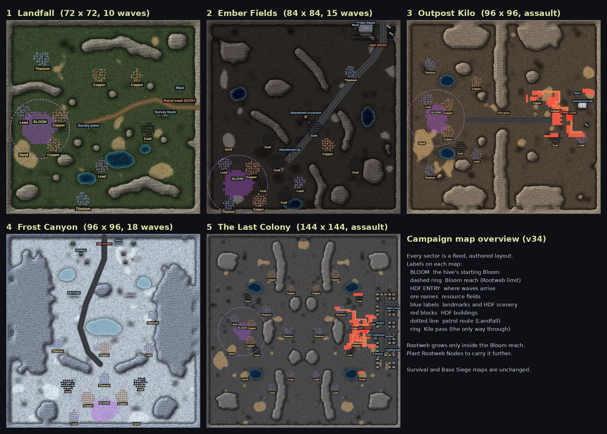

## What changed, in short

| Area | Before (v33) | Now (v34) |
| --- | --- | --- |
| Layout | the same handful of ridges and ore patches, scattered per seed | a hand-placed layout per sector, the same on every play |
| Look | one grey ground palette everywhere | five ground palettes (meadow, ash, mountain pass, ice, colony) with matching minimap colours |
| Landmarks | none | canvas props: survey markers, a survey truck, Ember Depot, abandoned machinery, the Kilo laboratory, barricades, artillery, houses, shelters, HDF Command |
| Bloom Rootweb | could cover most of the map on its own | grows only inside a local **Bloom reach** (11 to 18 tiles). Rootweb Nodes carry it further |
| Enemy routes | straight in from a random edge | waves arrive at a fixed HDF entry and follow the sector's road or track |
| First contact (Landfall) | patrol spawns near the turret | Patrol 7 walks the survey track by waypoints and stops when it sees the growth |
| Story during waves | none between the opening and the outro | short once-only radio and hive lines tied to waves and to what the player does |

## Rootweb in the campaign

- The Bloom's own Rootweb stops at its reach: 11 tiles in Landfall, 13 in Ember Fields, 14 in Outpost Kilo and Frost Canyon, 18 in The Last Colony. On Landfall that is about 7% of the map (357 tiles).
- Each reach covers the copper, lead and sand the tutorial and the first buildings need. Bigger fields (coal in Ember Fields, titanium in Frost Canyon, the far copper) sit just outside it.
- **Rootweb Nodes** are the way out. A node planted on the edge adds its own ring of Rootweb (the test plants one and the web grows from 357 to 406 tiles).
- Feedback: the HUD Rootweb line reads "Bloom reach N tiles, plant nodes". While a build tool is selected, a dashed ring shows the Bloom's reach and each node's radius, so it is clear where Rootweb will and will not grow.
- Required resources are never walled off: the map checks confirm every ore type the sector needs is either on the starting Rootweb or reachable by chaining nodes over open ground.
- Survival and Base Siege keep their old Rootweb behaviour (no reach limit). Old campaign saves made before v34 load with their old map and old Rootweb rules.

## The sectors

Coordinates are tiles, x across from the west edge and y down from the north edge.

### 1. Landfall (72 x 72, hold 10 waves)

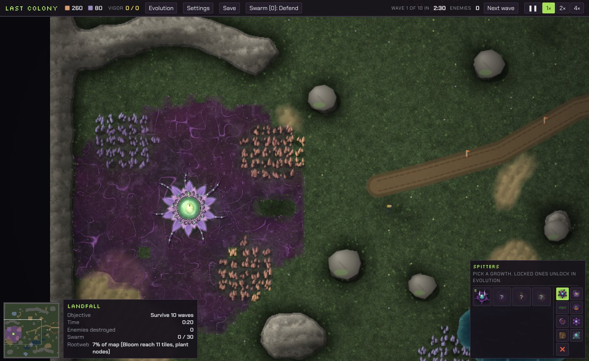

A green meadow with rocks, boulders, two small ponds and a marsh. The Bloom (12,40) sits in a hollow on the west side, shut in by a rock ridge to the north and boulders to the east, out of sight of the track.

- **Survey track**: a dirt track from the east edge (71,32) winding west to a survey tripod at (30,40). Orange survey markers stand along it, with a survey truck and crates at (58,35) and a radio mast at (64,26).
- **Resources**: copper (19,35) and (17,46), lead (6,34) and sand (6,46) inside the Bloom reach. Further out: copper (34,20), (48,20); lead (35,54); coal (52,40); titanium (13,14), (28,66).
- **HDF entry**: the east end of the survey track. Waves follow the track.
- **Tutorial**: unchanged. The tap spot, Thorn Spitter ring and node spot all fit on the starting Rootweb.
- **First contact**: when the first Thorn Spitter grows, three scouts of Patrol 7 come in at the east edge and walk the track by waypoints, a little apart. The scene starts when the lead scout comes within sight of the Rootweb, or near the Spitter, or reaches the end of the track. Turrets hold fire throughout (ceasefire), the scouts cannot be hurt, and they withdraw back along the track they walked and leave the map. Then waves begin.
- **Escalation** (radio): wave 1 the clearance team is sent in along the survey track; wave 3 vehicles lost, armour ordered; wave 6 the samples are still alive; wave 9 everything in the sector is committed. When the Rootweb first touches the track, the Bloom notices: "Hard trail. Their smell."
- The Seed Cluster's lines stay primitive (short fragments, no "I", no species name).

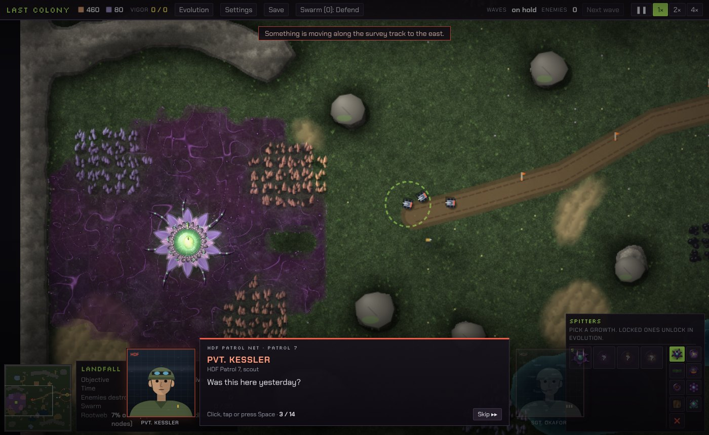

### 2. Ember Fields (84 x 84, hold 15 waves)

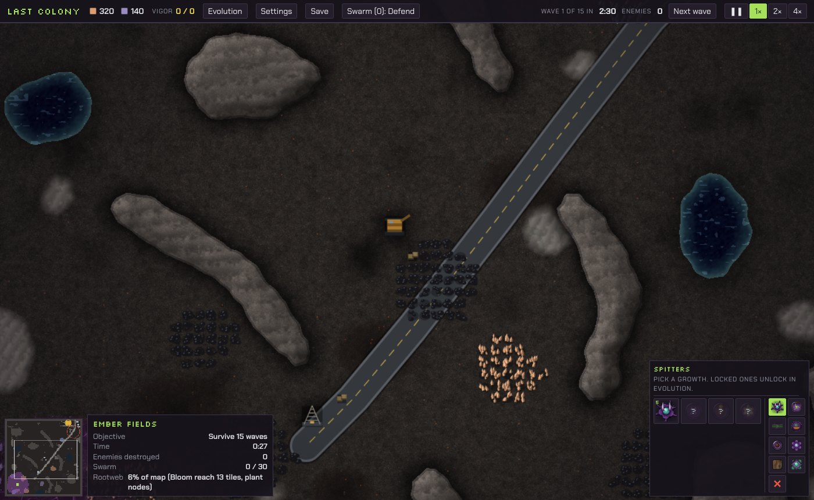

Scorched ash and coal plains broken by long rock ridges. Patches of burned ground show where clearance crews have already been.

- **Ember Depot** (66,2): a fenced depot with fuel tanks and a mast in the north-east corner. It is solid scenery outside the combat area, and its name first appears in the briefing.
- **Haul road**: from the depot gate (76,1) diagonally south-west to (35,60). Waves arrive at the depot (74,13) and come down the road.
- **Abandoned machinery**: a drilling rig (35,57) and an excavator (42,41) beside the road, with crates.
- **Resources**: copper (19,64), (22,78); lead (7,62); coal (24,70); sand (9,52); titanium (9,79) near the Bloom (13,71). Larger coal fields at (30,61), (33,75), (46,46), (26,51), (64,62); more copper (52,54), lead (40,70), titanium (62,22).
- **Events**: at the start the depot is pinged. Wave 1 the crews roll out with flamers; wave 4 the fire isn't stopping the growth; wave 8 the growth has spread past Dr Nymbris's containment estimates and flame tanks are committed; wave 12 bombers lift off from the depot. When the Rootweb reaches burned ground, the hive notices the old fire. None of these pause the game: they play as radio lines over the action.

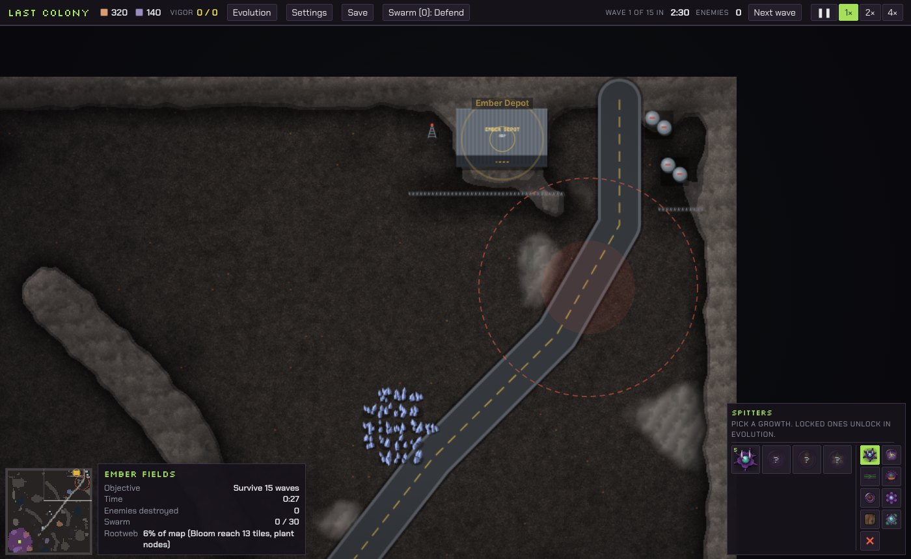

### 3. Outpost Kilo (96 x 96, destroy the outpost)

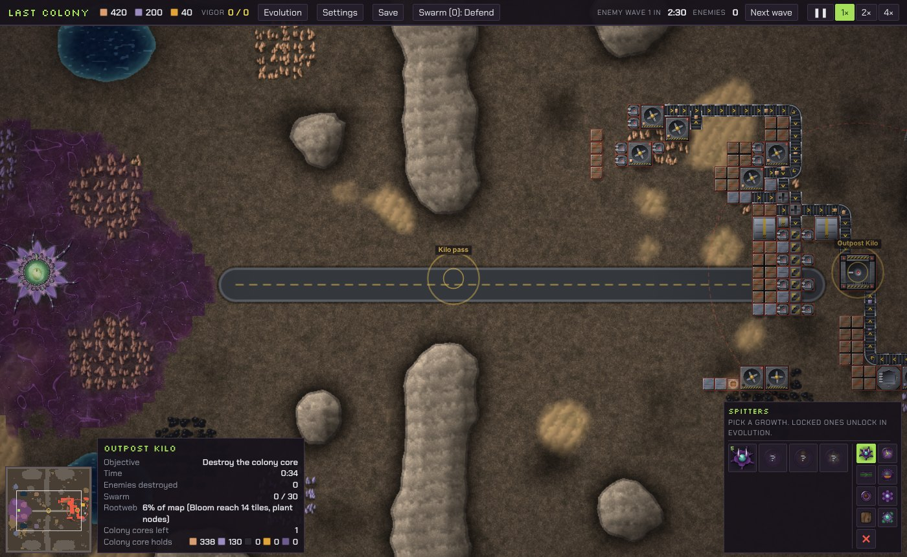

A mountain valley split north to south by the Kilo ridge, with **one pass** at (48,49), about 10 tiles wide. A road runs from the pass east to the outpost.

- **The outpost** (east side): the procedurally built HDF base, unchanged in rules: drills on the veins, belts into its core, Duo turrets, walls and gates. The test counts 11 drills, 45 belts, 15 Duos and 3 gates.
- **Containment laboratory** (85,41) with glass sample tanks, a silo (88,51) and a mast behind the core. Destroying the core plays the outro with the camera on the laboratory.
- **Resources**: on the hive side copper (20,42), (20,55), (34,30); lead (10,39), (34,66); coal (26,62); sand (7,57); titanium (11,22), (11,74). On the outpost side copper (73,41), (64,37); lead (86,58); coal (73,58); sand (90,36).
- **Events**: the outpost and the pass are pinged at the start. The hive notices the pass when its Rootweb nears it. Destroying a drill or a belt makes Colonel Ruiz report the loss (once each). When the core falls below about half health, Ruiz orders the laboratory sealed and the laboratory is pinged.

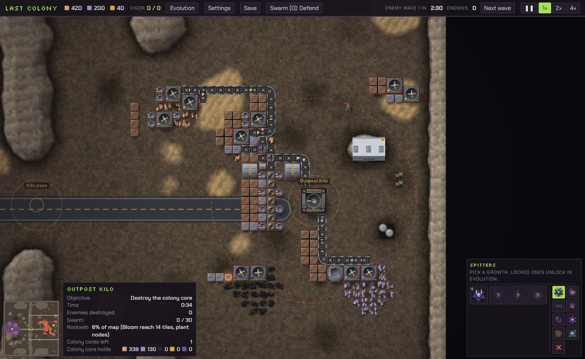

### 4. Frost Canyon (96 x 96, hold 18 waves)

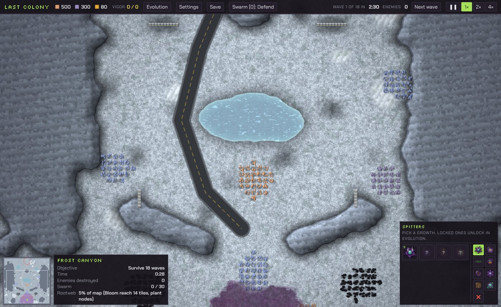

A frozen canyon between two cliff walls, with a frozen lake in the middle and ice pools in the north. Ice ground uses its own palette.

- **Canyon road**: from the north edge (48,1) down the west side of the lake to (46,64). Waves arrive at (48,7).
- **HDF staging** (north): four artillery pieces, tents, crates and a mast at the head of the road. **Barricades** across the canyon at (31,30), (59,30) and on the lower ridges at (29,58), (65,58).
- **Open ground** in the middle of the canyon for aircraft passes.
- **Titanium** at the foot of the cliffs and ridges: (48,71), (25,54), (72,40). Other resources: copper (40,81), (57,80), (48,56); lead (33,90), (70,56); sand (64,90); coal (30,74), (66,73). The Bloom is at (48,86).
- **Events**: wave 1 the column comes down the road; wave 5 the artillery is in position (pinged); wave 7 interceptors and bombers; wave 10 containment has failed at three more sites; wave 16 the siege tanks are committed. The hive notices the barricades when its Rootweb nears one.

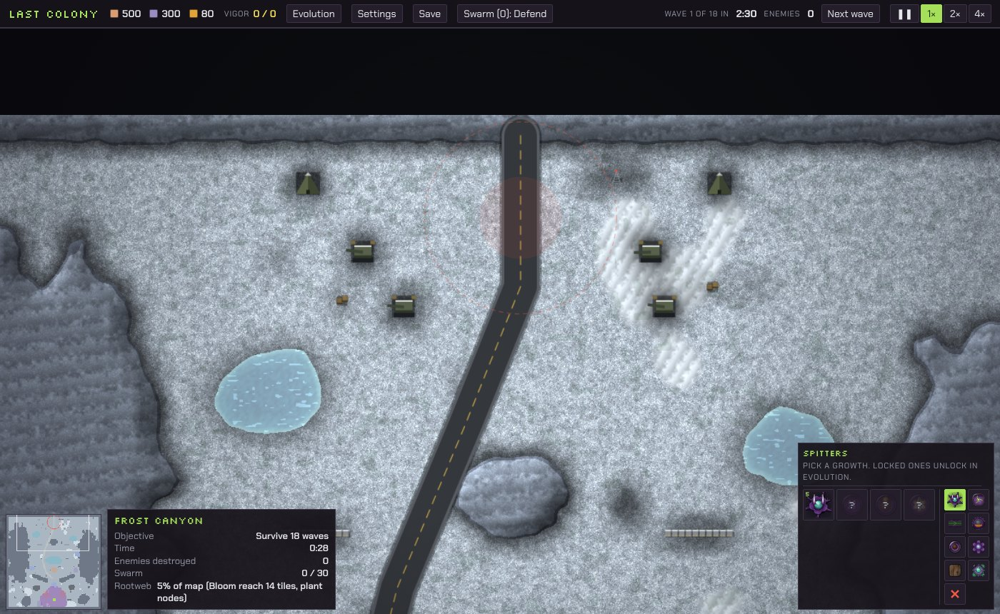

### 5. The Last Colony (144 x 144, destroy the fortress)

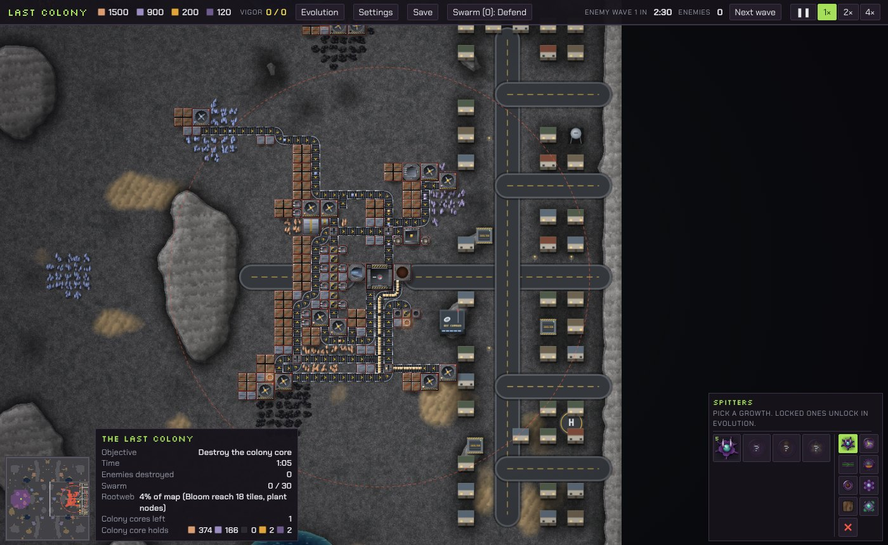

The valley is still mirrored, so the colony's economy and defences are the same as v33 (the test compares the supply routes, 16 turrets, 48 walls and 2 blast doors). New this version is the town behind the fortress, east of its core:

- **Streets and homes**: a main street (131,46) to (131,98) with side streets, and 40 houses.
- **HDF Command** (124,76), a water tower (138,56), a landing pad (137,87) and street lamps.
- **Three shelters** (128,67), (135,77), (127,90).
- **First contact**: the Seed Cluster's broadcast plays with the camera on HDF Command, where Varrick speaks from.
- **Ending**: the outro looks at the shelters as the survivors go underground.
- **Events**: the hive senses many small lives when its Rootweb nears the colony; the first breach of the outer wall sends civilians to the inner ring; when the core is failing, Varrick orders people to the shelters (pinged).

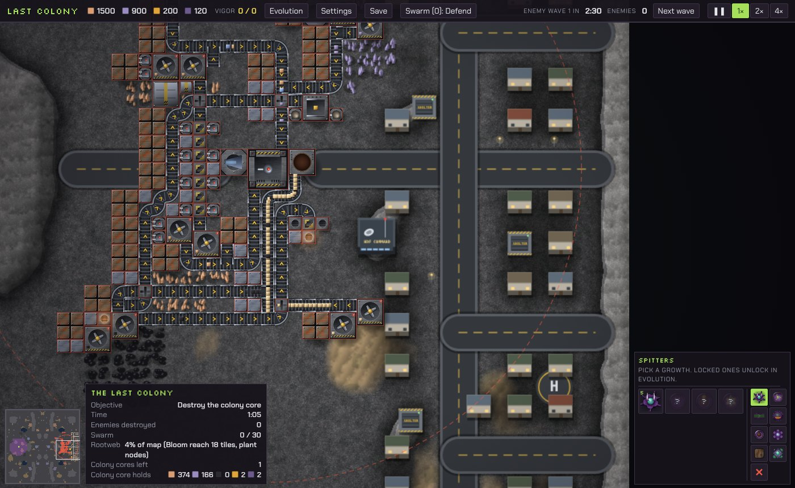

## Scripted event system

- Each sector has a list of events. Each event has a condition (a wave number, the Rootweb reaching a place, a structure count dropping, core health), optional radio lines and an optional map ping.
- Events fire **once**. Fired events are kept in the save (`G.evf`) and cleared when a sector is restarted.
- Conditions are checked once a second and skipped while a dialogue is open. They only look at counts and positions, so skipping a dialogue, a missing unit or a destroyed prop cannot break them.
- Radio lines appear one after another in the message feed (HDF radio in amber italics, the hive in purple) and never pause the game. Only the opening, first contact and the outros use the full dialogue box.
- Pings draw a pulsing ring with a label on the map and the minimap.

## Not changed

Costs, recipes, units, turrets, combat AI outside the scripted scenes, painted art, Rootweb rendering, the evolution tree, campaign progression, Survival, Base Siege, and the save format (new fields save automatically; old saves load).

## Tests

- `tests/mtest.js`: 18 mission checks (layouts, reach, node expansion, every wave of Landfall, Ember Fields and Frost Canyon reaching the Bloom and the sector being won, Ember Depot, the Kilo pass, outpost and laboratory outro, Frost staging and titanium, the colony district, first contact at Command, the shelter ending).
- `tests/mapview.js`: draws the overview images and checks for unreachable ore, props on ore, a blocked track and broken supply routes.
- `tests/lcstory.js`: plays the Landfall tutorial and the patrol scene through the real input path.
- `tests/ncheck.js`: now also checks the new radio lines (no species name in Mission 1, the hive never says "I" or its human name).
