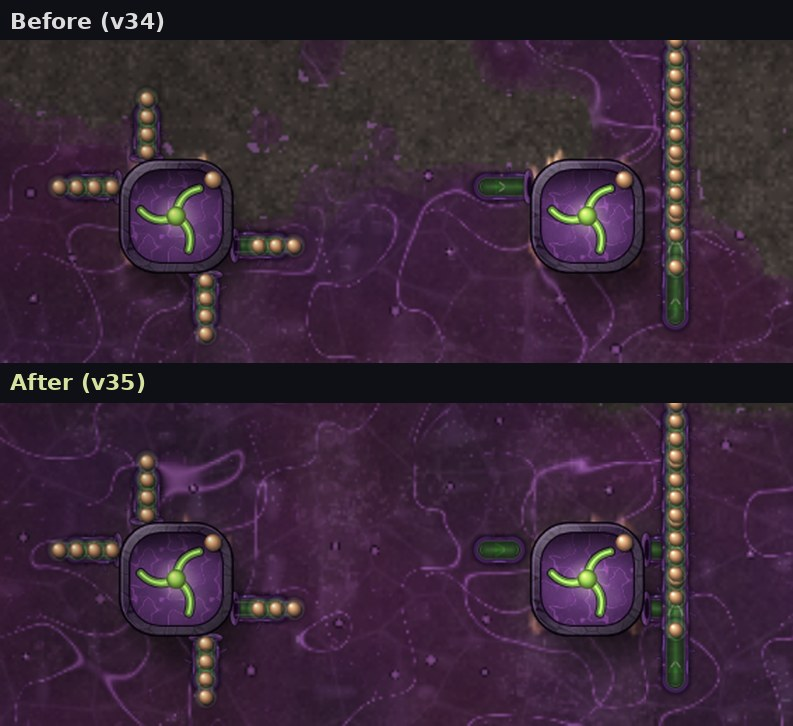
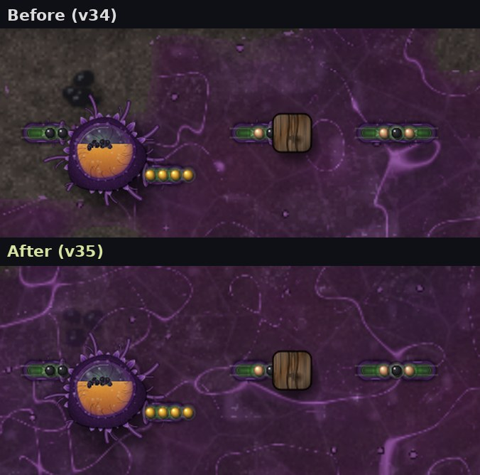
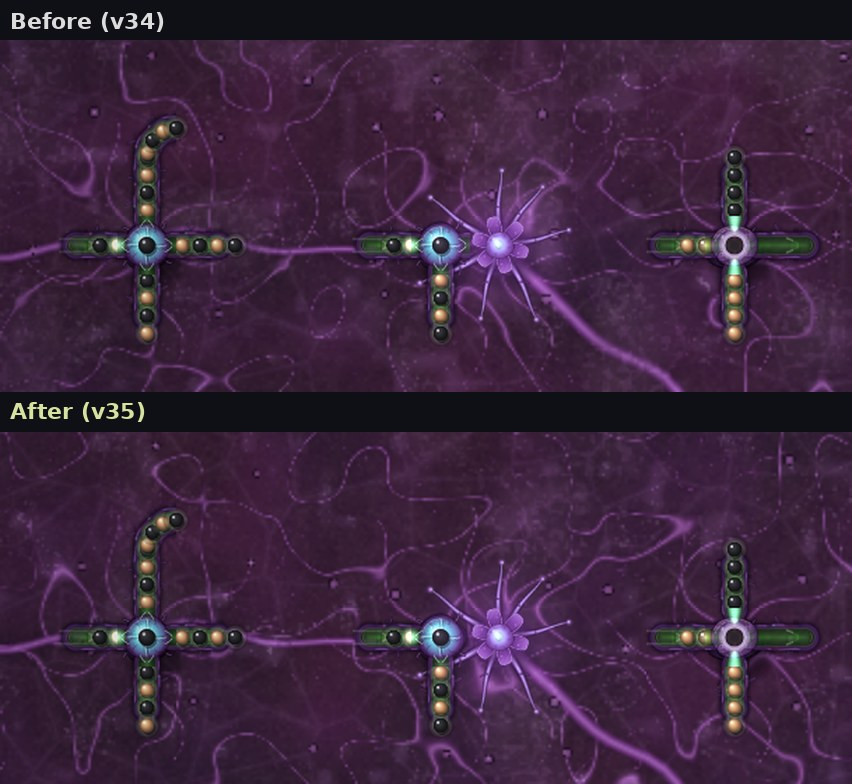
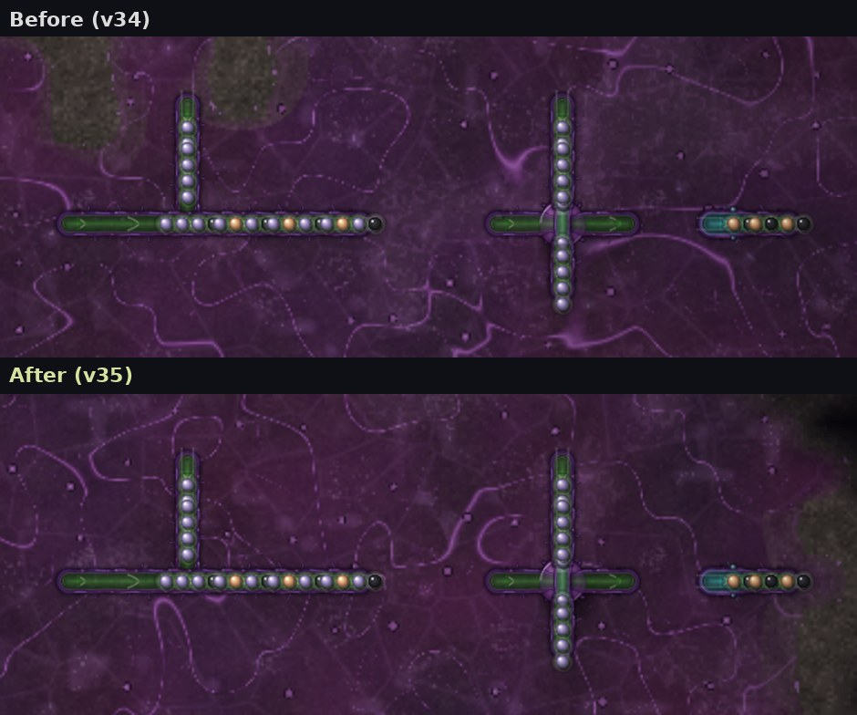
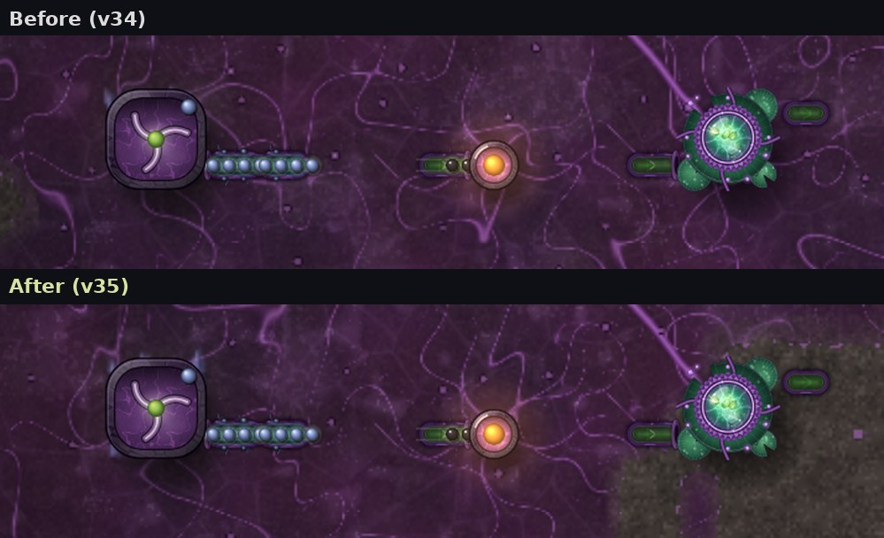
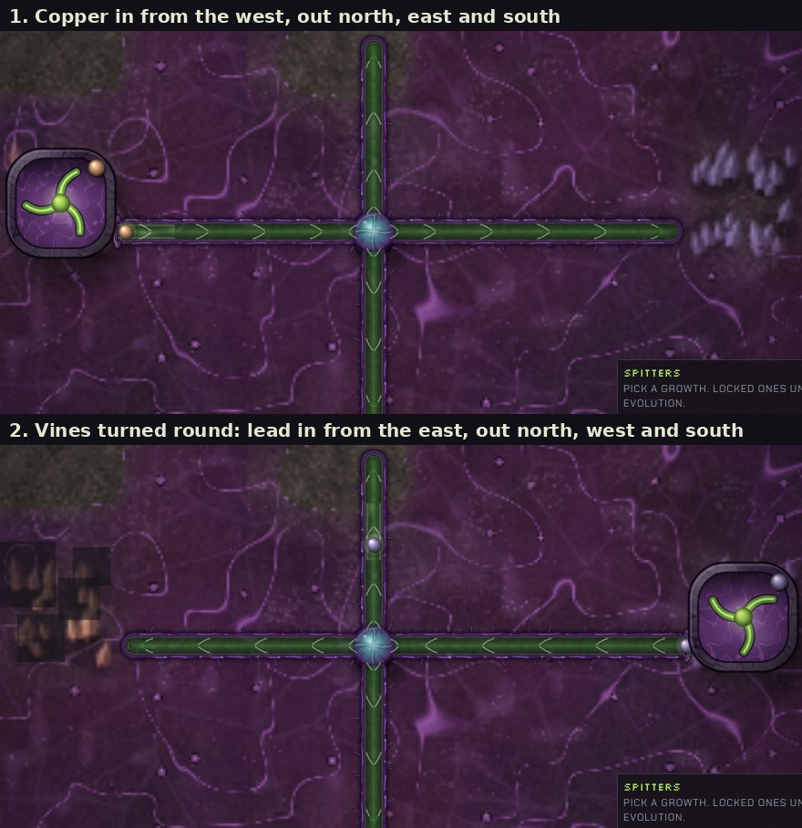
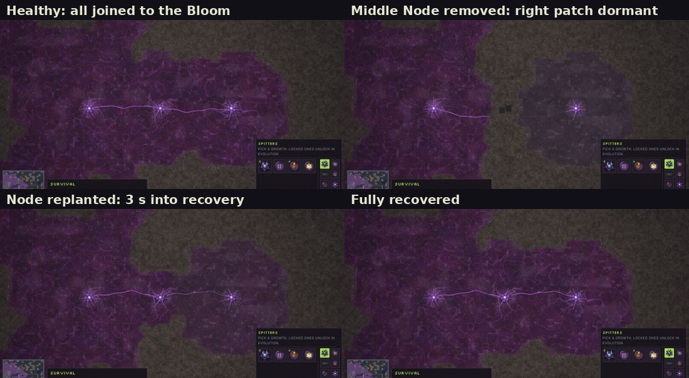
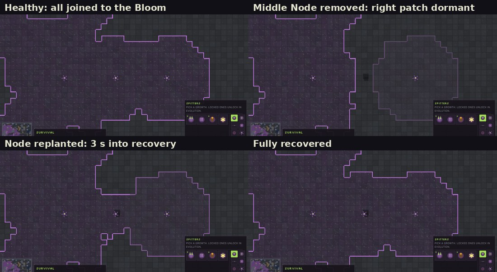

# v35: connections that follow real transfer, Splitter Bulb checks, dormant Rootweb

Three parts, all artwork and feedback only. Costs, recipes, speeds, routing, turrets, Rootweb growth, spawning, campaign content and the save format are unchanged. `tests/ident35.js` plays the same colony in v34 and v35 (Survival, Base Siege and the Ember Fields sector, with a Rootweb patch cut off in two of them) and the full saves are byte-identical.

## 1. Vine connections

**Before:** a vessel opened into a fleshy collar wherever it touched a growth, even where nothing could pass (a vine pointing into a Root Tap or a wall, two vines head-on). A Root Tap beside a vine's side pushed items into it with nothing drawn there.

**Now:** every opening is drawn from the same rules the simulation uses to move items:

| Where | Before | Now |
| --- | --- | --- |
| Vine pointing into a Root Tap, wall, Node or Bellows | collar | sealed cap (nothing passes) |
| Two vines pointing at each other | joined | both capped |
| Root Tap (or Deep Root, Resin Gland, Chitin Vat) beside a vine's side | nothing | side stub and collar (it really feeds in) |
| Vine fed only from one side by a growth | straight | bends out of the growth, starting in a collar |
| Vine leading away from the Bloom | collar | cap (the Bloom never gives items out) |
| Vine out of a Root Tap, into the Bloom, a Resin Gland, Sap Burner, Spawning Pod or turret | collar | collar (unchanged) |
| Splitter Bulb or Sorting Gland next to a Node or Bellows | channel | closed (nothing passes) |
| Splitter Bulb or Sorting Gland next to a wall | closed | closed |
| Splitter Bulb or Sorting Gland next to anything that passes items with it | channel | channel (unchanged) |

The right-hand Root Tap: the vine running past it now shows where the tap feeds in, and the vine pointing into it is sealed at both ends.

From the left: a Resin Gland with a vine in and a vine out (both keep their collars); a vine into a wall, now capped; two vines head-on, now both capped.

The middle Splitter Bulb sits beside a Rootweb Node: the side facing the Node no longer opens a channel.

## 2. Splitter Bulb

The Splitter Bulb already had no fixed entrance in the simulation: it takes an item from any side and hands it to the next neighbour that will take it, never back the way it came. No code change was needed. `tests/btest.js` now proves it with 13 checks:

- input from each of the four sides: out through the other three, 20/20/20, nothing lost
- reversing the vines: the old entrance becomes an exit and the old exit an entrance
- rotating one neighbouring vine to face the bulb turns that side from exit to entrance
- two inputs at once, split over two exits, nothing duplicated
- one, two or all exits blocked: the rest take everything; with all blocked, items wait and flow again when reopened
- long chains of bulbs, with vines between and touching
- save and load with items inside the bulb and vines
- every item accounted for (made = inside + delivered), no page errors

In the close-up, the copper tap on the west fed 23 items in 40 seconds (east 7, north 8, south 8). After the vines were turned round and a lead tap planted on the east, 24 lead came through in 40 seconds (west 8, north 8, south 8), and nothing went back east.

## 3. Dormant Rootweb

Only the Bloom feeds the Rootweb. Rootweb joined to the Bloom through other Rootweb is fed. A patch with no Rootweb path back to the Bloom goes **dormant**: it stops pulsing and fades to a dull grey-violet over about 14 seconds. Join it up again and it is fed at once, pulses start and its colour returns over about 6 seconds.

- It is a sign only. Buildings on dormant Rootweb keep working, nothing is damaged or slowed, and Nodes keep growing it. You can still build on it.
- A Rootweb Node is not a source by itself: a Node whose patch does not reach the Bloom's Rootweb is dormant from the start.
- If several routes join a patch to the Bloom and one is cut, the patch stays fed through the others.
- A patch is cut off when its last link of tissue is gone. Destroying the Node that linked it does not cut it at once: the Node's Rootweb recedes tile by tile first, which took about 15 seconds in the screenshots below.
- Nothing new goes into saves. After loading, supply is worked out again from the saved Rootweb and shown straight away.

Each sheet: a chain of three Nodes out from the Bloom; the middle Node removed (20 seconds after the right-hand patch was cut off); the middle Node planted again, 3 seconds after it joined; and fully recovered.

`tests/dtest.js` covers it with 12 checks on both the 2D painter and the GPU: fully joined, two routes with one cut, cutting the last link, no new pulses in the cut patch, the gradual fade, growth while cut off, a lone Node, several cut patches at once, save and load while dormant, reconnecting, building on dormant Rootweb, and no page errors.

How it is drawn on each preset is in [art/ART-GUIDE.md](../art/ART-GUIDE.md) (sections *Connections that follow real transfer* and *Dormant Rootweb*).

## Performance

Measured with `tests/perf35.js` in headless Chromium with software drawing, so a real browser is faster. The Last Colony map (144×144) with 33 Rootweb Nodes in twelve chains; the middle Node of every chain is destroyed and the game runs 35 seconds while the 12 outer patches (about 120 tiles) are cut off and fade. Times are per frame, averaged over two runs:

| | v34 | v35 |
| --- | --- | --- |
| Supply flood fill (`webSupply`), one call | n/a | 0.28 ms |
| Supply and fade, per frame (`webSupply` + `webSupTick`) | n/a | 0.2 to 0.35 ms |
| Fade step with nothing fading | n/a | under 0.01 ms |
| Whole frame, painted 2D Rootweb (`render`) | 13.9 ms | 14.6 ms |
| Rootweb repaints, painted 2D (`paintWeb` calls in 35 s) | 3,354 | 3,351 |
| Whole frame, GPU Rootweb (`render`) | 3.8 ms | 3.9 ms |
| GPU upload (`glUpload`, now including the dormancy texture) | 0.18 ms | 0.27 ms |

The supply check only runs after the Rootweb changes and at most four times a game second, and the fade step returns at once when nothing is fading. A fade repaints each 2D tile at most 8 times, and the repaint shares the existing per-frame budget, so the number of repaints in the run was the same as v34. Frame-time percentiles were the same in both builds (2D: 66.6 ms median in both, the slow software renderer dominates).

## Tests

Every suite was run one at a time on the v35 build:

| Suite | Result |
| --- | --- |
| `ident35.js`: same colony in v34 and v35 | byte-identical saves in Survival, Base Siege and Ember Fields (two of them with cut-off Rootweb) |
| `btest.js`: Splitter Bulb | 13 of 13 |
| `dtest.js`: dormant Rootweb, 2D painter and GPU | 12 of 12 on each |
| `otest.js`: painted organs, including the same colony in v34 and v35 with art on and off | 13 of 13 |
| `vtest.js`: painted vines | all pass |
| `wbtest.js`: Living Rootweb, 2D and GPU | all pass on 2D; on the GPU only case 11 (frame time), which headless software WebGL cannot measure, as before |
| `mtest.js`: campaign maps and missions | 19 of 19 |
| `oldsave.js`: v34 saves load in v35 | pass |
| `ncheck.js`, `nstory.js`: naming rules and story order | pass |
| `qtest.js`, `gpuapp.js`: quality presets, desktop app GPU | pass |
| `lcquick`, `lcskir`, `lcstory`, `lcheld`, `lcsave`, `lctest`, `lcart`, `lcbloom`, `lcweb`, `lchd`, `lcspit` | pass, no page errors |
| Windows app smoke test (Electron) | all four presets on the GPU, painted art ready, no errors |

`lcstory.js` clicked a fixed distance from an ant to give it a move order. On Landfall that spot can be the rock ridge, which deselects the ant instead, and the test then failed on v34 and v35 alike. It now clicks the nearest open ground.

