# v37: painted Root Tap, Deep Root and Chitin Vat

The three 2x2 production growths are now painted organs in the same wet, translucent style as the Bloom, Spawning Pod, Thorn Spitter, Resin Gland and Rootweb. This is artwork only. Mining rates, ore, the chitin recipe (1 coal and 2 sand), the 30 vigor the vat needs, costs, footprints, health, building rules, throughput, rotation, routing, enemies, the campaign and the save format are unchanged. How it is drawn is in [art/ART-GUIDE.md](../art/ART-GUIDE.md), section *Painted extraction (v37)*. What the code does today is in [v37-extraction-inspection.md](v37-extraction-inspection.md).

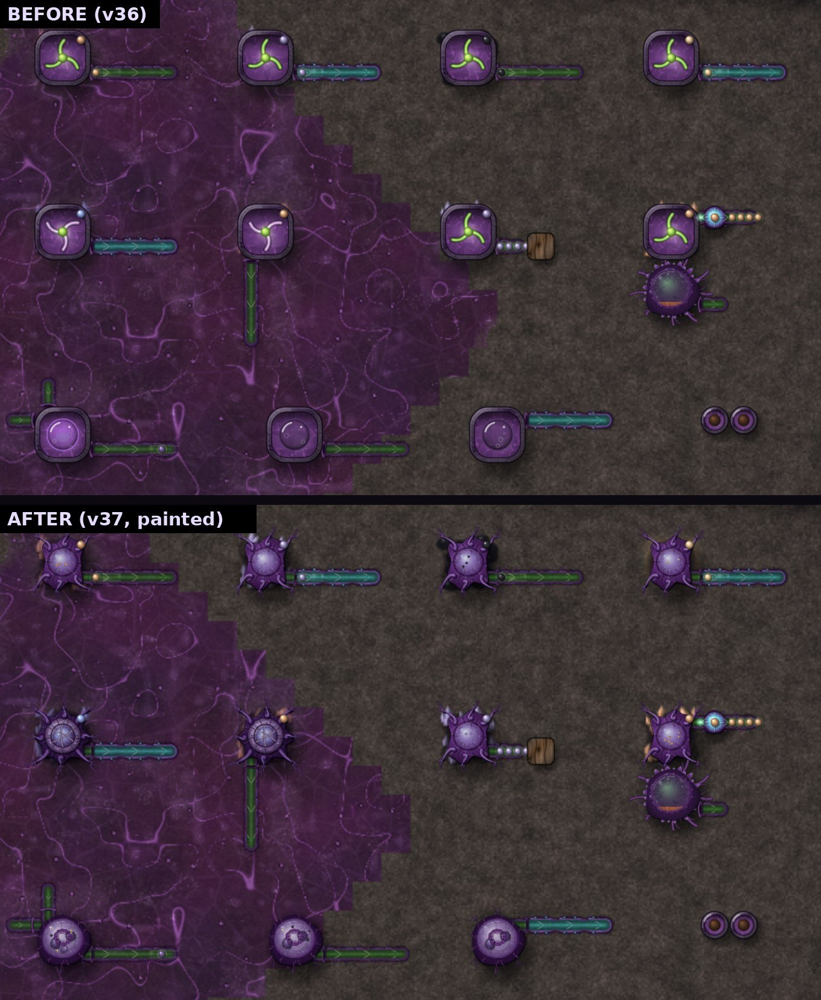

Normal zoom (1×) on a high-density screen. Top row: Root Taps on copper, lead, coal and sand. Middle row: Deep Roots on titanium and copper, a Root Tap whose only vine runs into a wall, and a Root Tap beside a Splitter Bulb and a Resin Gland. Bottom row: a Chitin Vat working, one short of sand, one with nothing to do.

## The three organs

- **Root Tap:** a thick purple root crown, rooted into the deposit by six tendrils that end in pits on the ore, with an exposed translucent absorption sac in the middle. Grains of whatever it is mining (copper, lead, coal or sand) float in the sac. The corner resource icon is the same one as before.
- **Deep Root:** the same organ, evolved: a heavier crown on eight thicker tendrils, a smaller pressure chamber held by three hardened ribs, and a collar of pale cellulose segments with faint blue mineral glints. No drill bits.
- **Chitin Vat:** a swollen, semi-transparent vat on a deep-purple foundation, with pale fluid, hardened chitin plates inside, membrane folds round the opening, nutrient veins and vessel openings for its inlets and outlet.

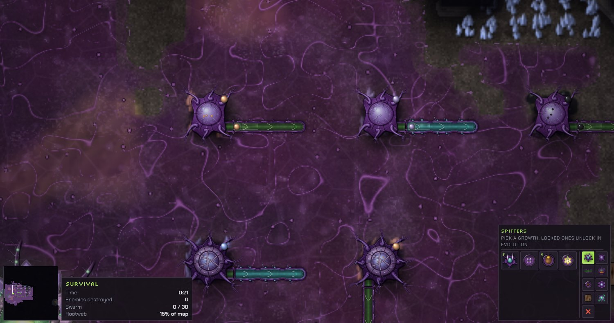
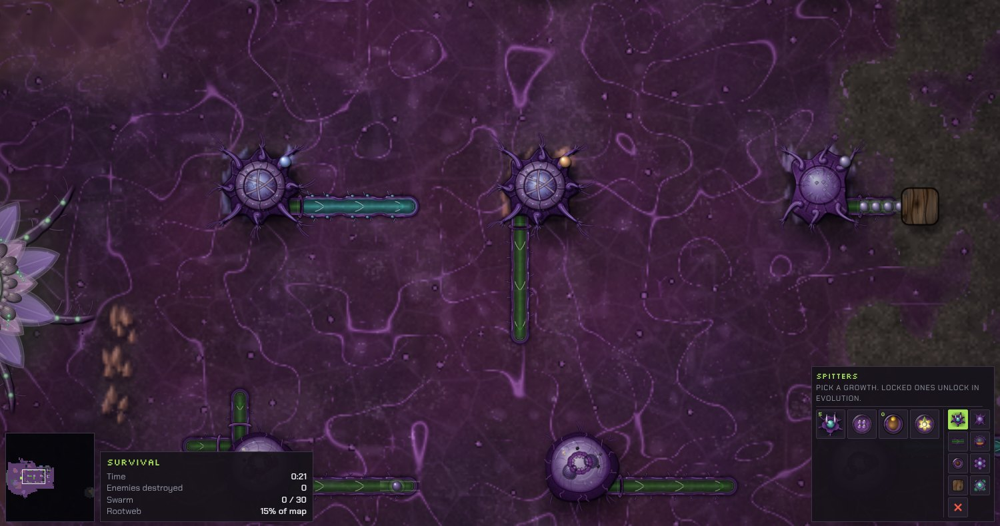

## Animation from what the game really does

None of the three had animation events, so the art works them out from the growth's own state each frame, and stores what it saw outside the block so nothing reaches a save. A tap's progress dropping is one piece mined. Its store going down is one piece handed on, and the game's round-robin pointer says which neighbour took it. The vat's progress dropping is one plate finished, and its coal or sand going up is one piece arriving.

**Root Tap, one piece mined** (frames taken from the game canvas right after a real mining event): the tendrils contract, a pulse carries a grain up two of them into the sac, the sac fills, and the copper grain leaves along the vessel into the vine.

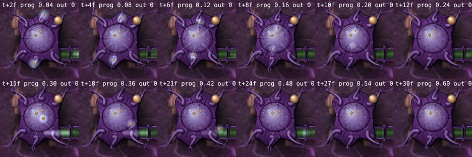

**Deep Root, one piece of titanium:** slower, stronger contractions, three tendrils carrying the pulse through the internal channels, a harder swell of the pressure chamber, then the piece out along the Swift Vine.

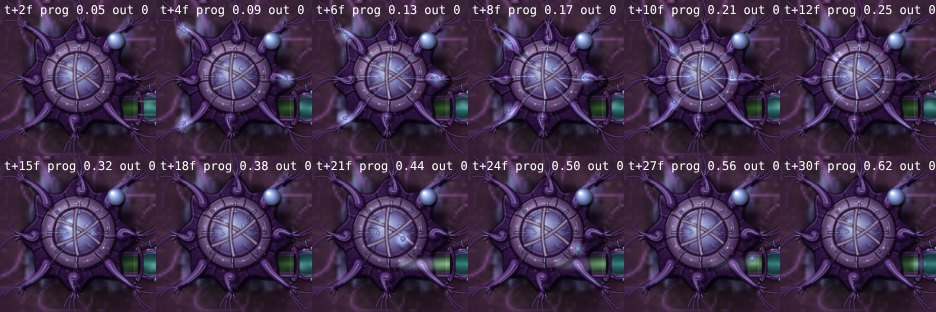

**Chitin Vat, one plate:** coal and sand come in from the vessels that brought them, the fluid turns, the next plate appears as progress climbs, the vat squeezes and its folds close when the plate is done, and the chitin leaves along the outlet.

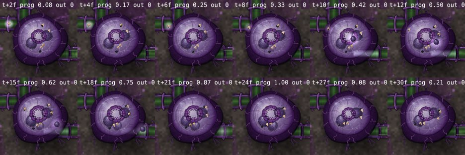

At rest (a tap backed up or with nothing to mine, a vat short of an input, full or without vigor), the organs barely breathe, the fluid slows and the plates stay visible.

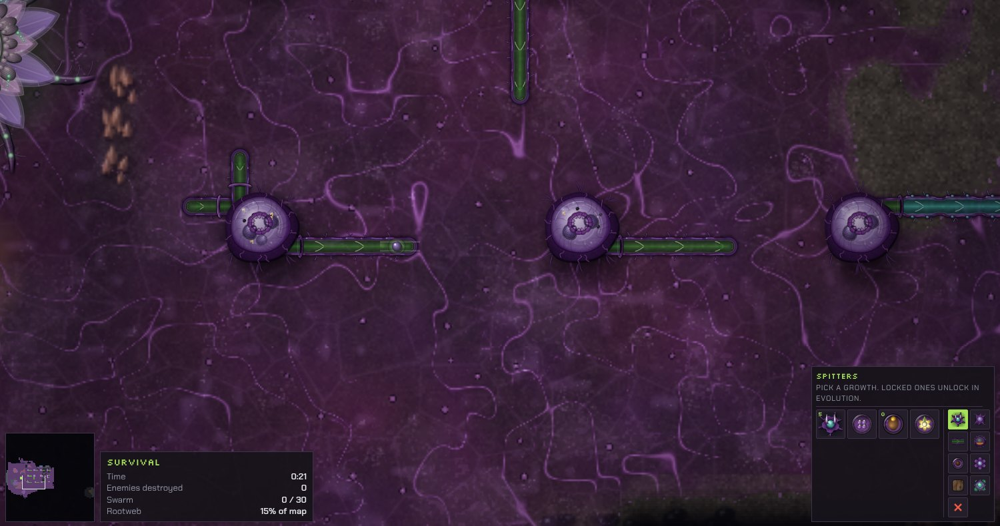

## Connections

An edge tile gets a vessel opening only where a neighbour can really take this growth's item, as the game's own `accepts()` decides it. Vines and Swift Vines leaving a tap or vat run straight into the opening. A vine pointing into a tap gets no opening, and neither does a Resin Gland beside a copper tap (it never takes copper). Vine ends are drawn exactly as in v35; the pending global vine fixes are not part of this change.

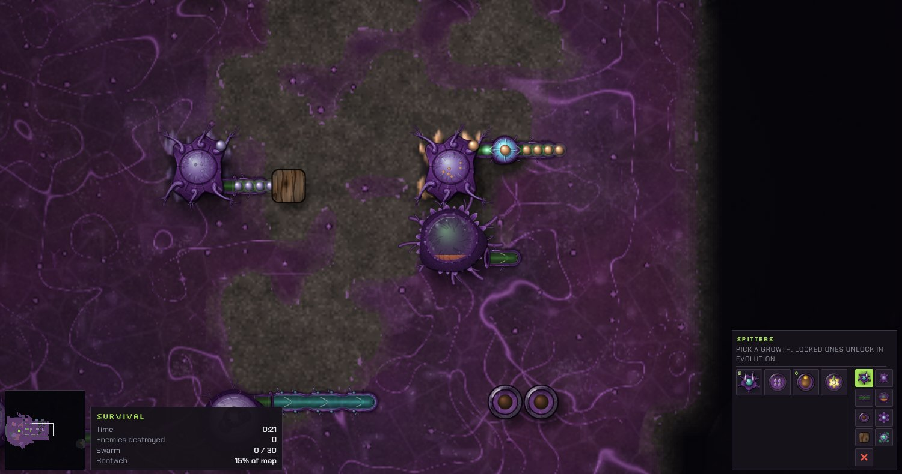

## Colony

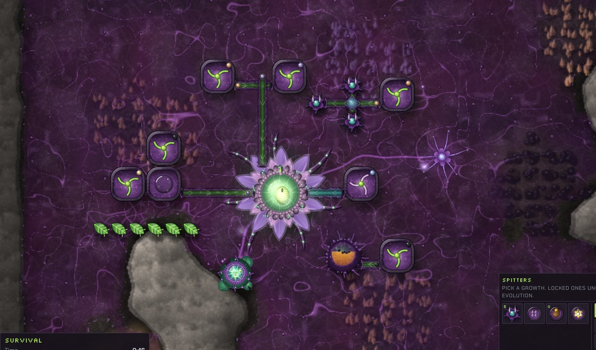
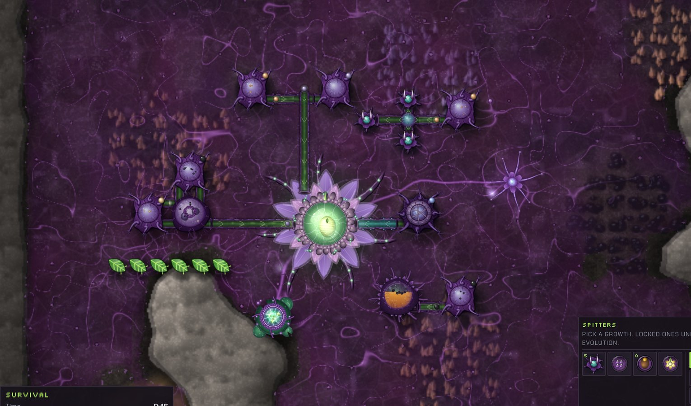

Copper and lead taps into the Bloom, a Deep Root on titanium along a Swift Vine, a Chitin Vat fed directly by a coal tap and a sand tap with Sunleaves for vigor, a Splitter Bulb feeding Thorn Spitters, a Resin Gland, a Spawning Pod and a Rootweb Node. High preset, zoom 1.6×.

## Zoom and presets

Zoomed out past 0.75×, or past 32 taps, 32 Deep Roots or 24 vats on screen, each kind draws one cached picture plus its resource icon, and the channels still flash when a piece is mined. Low quality and painted art off give the previous look.

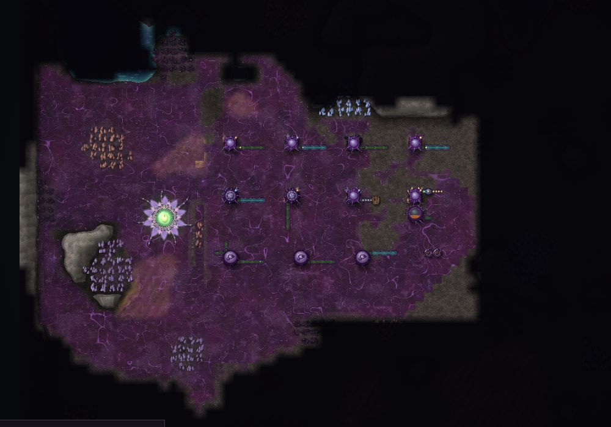
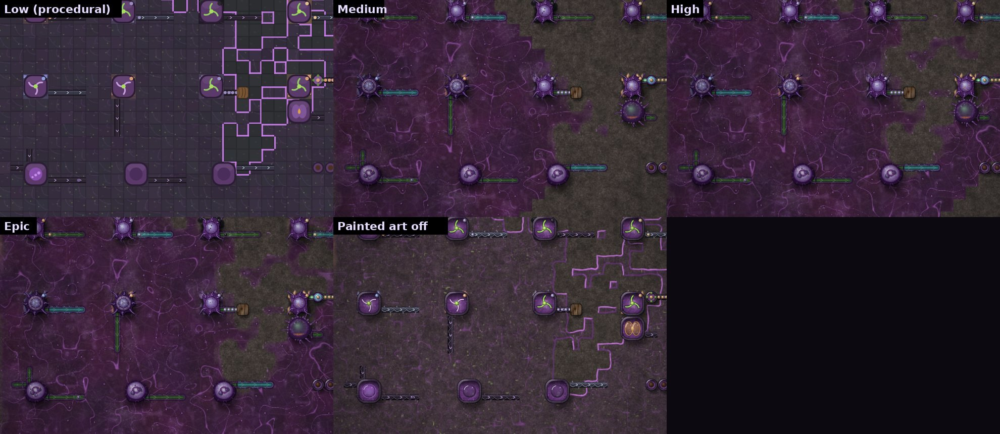

## Performance

Measured with `tests/xperf37.js` in headless Chromium on Medium (software drawing, so a real browser is faster), everything working and in view. Median time for the whole frame's `render()`:

| On screen | v36 | v37 |
| --- | --- | --- |
| 25 Root Taps | 2.9 ms | 3.5 ms (full motion) |
| 50 Root Taps | 5.1 ms | 3.4 ms (cached pictures) |
| 100 Root Taps | 6.1 ms | 4.4 ms (cached pictures) |
| 25 Deep Roots | 2.8 ms | 3.3 ms (full motion) |
| 100 Deep Roots | 6.1 ms | 4.3 ms (cached pictures) |
| 25 Chitin Vats | 3.1 ms | 2.5 ms (cached pictures) |
| 100 Chitin Vats | 5.9 ms | 4.5 ms (cached pictures) |
| 50 mixed | 4.4 ms | 4.7 ms (full motion) |
| 100 mixed | 6.6 ms | 4.8 ms (cached pictures) |

The full table, with means, is in the art guide.

## Tests

| Check | Result |
| --- | --- |
| `ident37.js`: the same extraction colony in v36 and v37, drawn every other step with art on, through a wave | byte-identical saves on Medium and Epic |
| `xtest37.js` | 40 of 40 |
| Root Taps on copper, lead, coal and sand; Deep Roots on titanium and copper | each ships only its own ore, the same amounts as v36 (Test Range and Survival) |
| Chitin Vat ratio | 47 chitin from 47 coal and 94 sand in the Test Range, the same as v36 |
| Chitin Vat short of sand, or without vigor | makes nothing, progress does not move, the art shows it resting |
| Idle and working | one tendril pulse per piece mined; a backed-up tap shows its last pulse and then rests |
| Vines and Swift Vines | openings where a vessel leaves, none for a vessel pointing in or a neighbour that never takes the item |
| Damage and destruction, zoom 0.5× to 2.5×, art on and off | no page errors; hit flash and health bars unchanged |
| Missing PNG | each of the three falls back to its previous look with one console warning; other organs stay painted |
| Low, Medium, High, Epic | Low uses the previous look, the others the painted art; no page errors |
| Save and load | the saved fields are the same set v36 saves; a v36 save loads in v37 and plays on |
| Regression suites | see the art guide and `tests/README.md` |
