# v38: painted Sap Burner, Sunleaf and Spore Bellows

The Nymbri's vigor growths and its Rootweb accelerator are now painted organs in the same wet, translucent style as the Bloom, the Rootweb, the vines, the Splitter Bulb family and the Root Tap family. This is artwork only. Vigor amounts, coal use, the Bellows' doubled spread within 12 tiles and its 10 vigor, costs, footprints, health, building rules, campaign behaviour and the save format are unchanged. How it is drawn is in [art/ART-GUIDE.md](../art/ART-GUIDE.md), section *Painted energy growths (v38)*. What the code does is in [v38-energy-inspection.md](v38-energy-inspection.md).

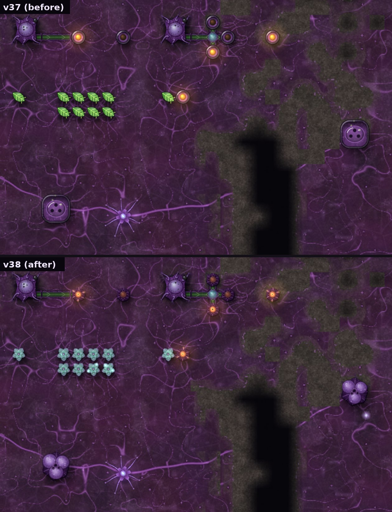

Normal zoom (1×) on a high-density screen. Top row: a Sap Burner fed by vine from a coal tap, one with no coal, three round a Splitter Bulb and one kept stocked. Middle row: a Sunleaf, a cluster of eight, and one beside a burner. Bottom: a Spore Bellows beside a Rootweb Node, and one far from anything still growing.

## The three organs

- **Sap Burner:** a compact, dense violet metabolism organ ringed by heavy lobes and a rim of fleshy folds round a small translucent reaction chamber, with heat-darkened tissue round it. The coal it is digesting sits inside and glows amber while it works.
- **Sunleaf:** a rosette of broad translucent lily-pad leaves, pale turquoise fading to lavender, with fine veins converging on a softly luminous heart.
- **Spore Bellows:** three translucent sacs heavy with spore mist on a fleshy root base, breathing out through frilled vents where they meet.

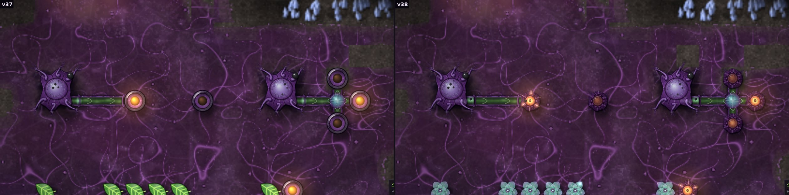
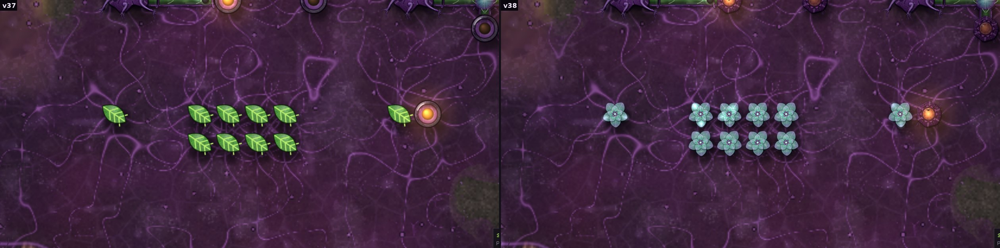

## Animation from what the game really does

None of the three had animation events, so the art works them out from the growth's own state each frame and keeps what it saw outside the block, so nothing reaches a save. A burner's burn timer jumping back up is one piece of coal taken in (the game burns each for 2 s), and its coal store going up is a piece arriving. The Sunleaf makes its vigor all the time and has no other state, so it has one calm ambient rhythm. A Bellows breathes in full only while it is really boosting: the swarm has at least a quarter of the vigor it needs, and a Rootweb source within its 12 tiles has just covered new ground.

**Sap Burner, one piece of coal** (frames from the game canvas, starting when the burn timer jumps back up): the lump slides in and the folds open, the chamber swells and its glow surges, vigor pulses run out along its vessels twice, and the glow eases off as the piece runs out. A new piece of coal arrives along the vine at +0.5 s.

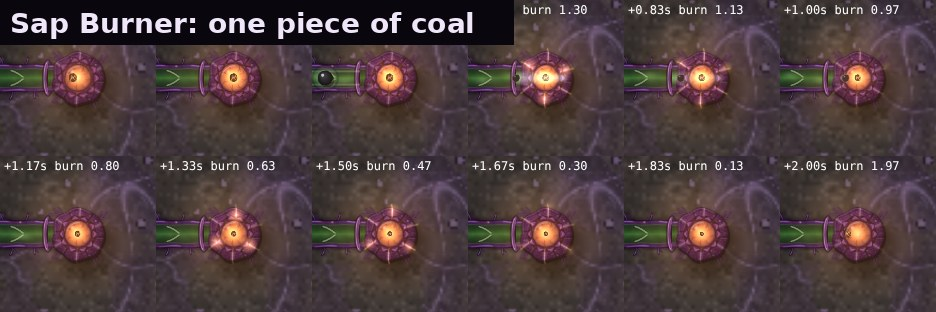

**Sunleaf, one pulse:** light drifts over the leaves, pulses gather from two leaf tips to the heart, the heart brightens, a fainter pulse runs out along a root.

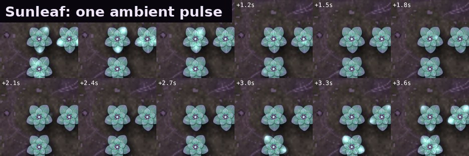

**Spore Bellows, one breath while the node beside it is spreading** (the number is how far the node has got through its tiles): the sacs fill one after another and the mist thickens, they squeeze and puff spores from the vents, and spores drift out to the tiles just covered, which glint as they settle.

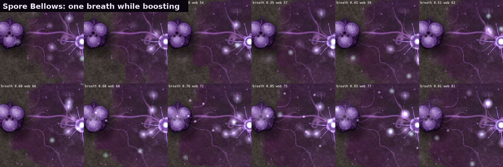

At rest, a burner with no coal goes dark and only breathes. A Bellows whose sources have finished spreading finishes its breath and rests with a few spores drifting inside. Without vigor its sacs sag. There is no fog when it is idle.

## Colony

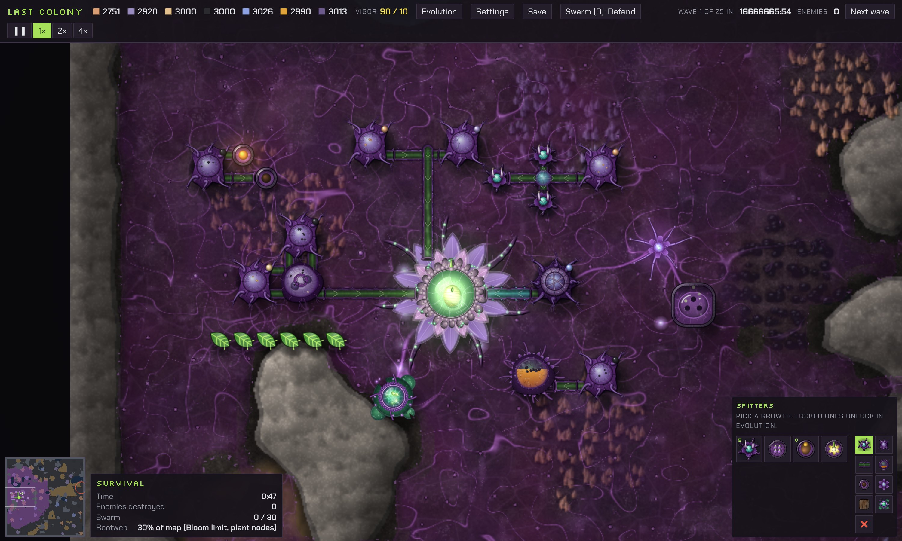
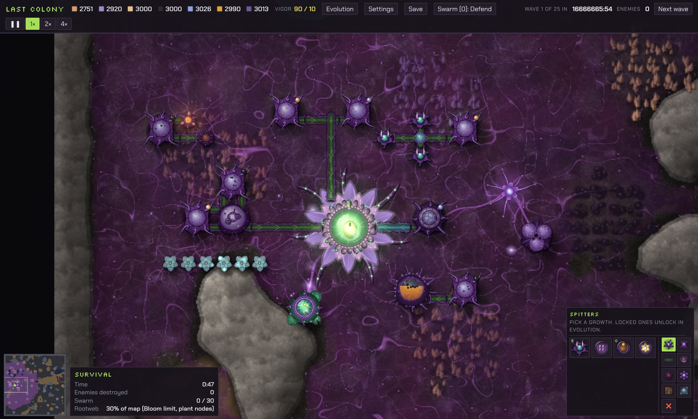

Two Sap Burners on a coal tap, a row of Sunleaves, and a Spore Bellows beside a Rootweb Node that has just been planted, with the painted taps, Chitin Vat, Bloom, Thorn Spitters, Resin Gland, Spawning Pod, Splitter Bulb and vines. High preset, zoom 1.6×.

## Zoom, crowds and presets

Zoomed out past 0.75×, or past 40 Sap Burners, 40 Sunleaves or 16 Spore Bellows on screen, each kind draws one cached picture. A burner still shows whether it is burning, and a Bellows' veins still flash when it breathes out. Low quality and painted art off give the previous look, and so does a missing image.

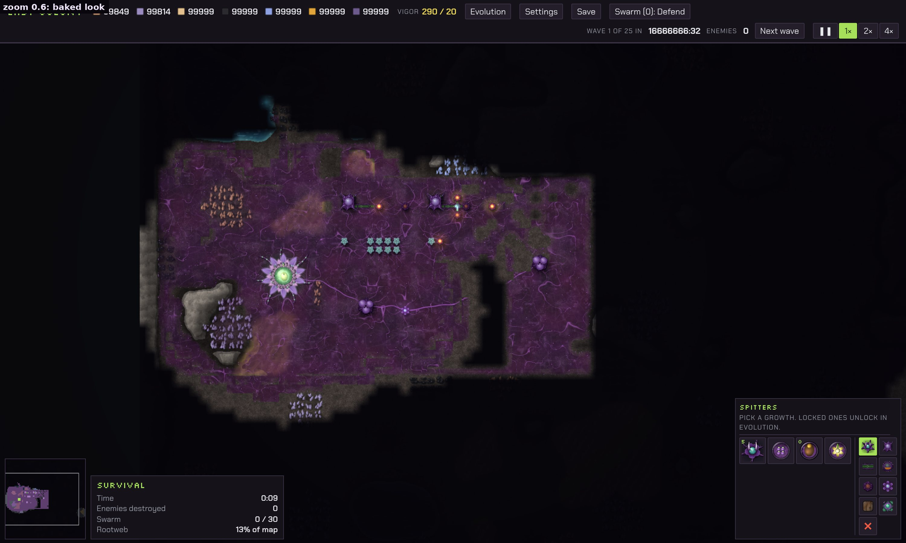
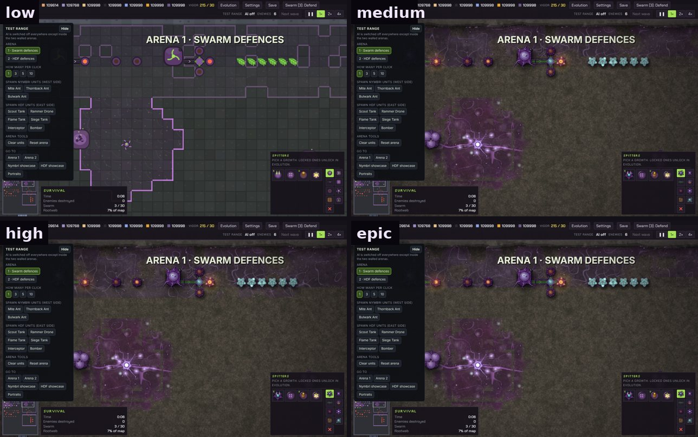
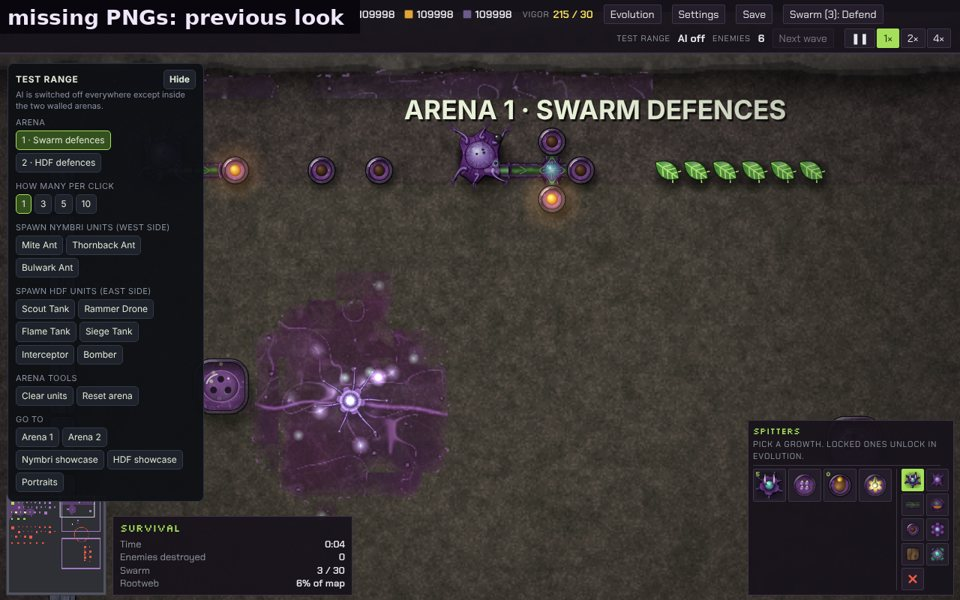

## Performance

Measured with `tests/xperf38.js` in headless Chromium on Medium (software drawing, so a real browser is faster), everything in view and every burner burning. These are times for the whole frame's `render()`. The median is the useful number. The background Rootweb repaint of the freshly laid test ground causes occasional slow frames in both builds, and their total time is the same in both.

| On screen | v37 median | v38 median | v37 mean | v38 mean |
| --- | --- | --- | --- | --- |
| 25 Sap Burners | 2.3 ms | 2.6 ms (full motion) | 13.4 ms | 13.6 ms |
| 50 Sap Burners | 2.6 ms | 2.6 ms (cached pictures) | 14.5 ms | 15.7 ms |
| 100 Sap Burners | 3.0 ms | 3.0 ms (cached pictures) | 16.6 ms | 17.2 ms |
| 25 Sunleaves | 2.1 ms | 2.5 ms (full motion) | 12.0 ms | 13.1 ms |
| 50 Sunleaves | 2.2 ms | 2.5 ms (cached pictures) | 11.3 ms | 13.4 ms |
| 100 Sunleaves | 2.4 ms | 2.7 ms (cached pictures) | 12.3 ms | 12.6 ms |
| 25 Spore Bellows | 2.6 ms | 2.2 ms (cached pictures) | 13.6 ms | 13.1 ms |
| 50 Spore Bellows | 3.1 ms | 2.5 ms (cached pictures) | 16.4 ms | 14.0 ms |
| 100 Spore Bellows | 4.1 ms | 2.8 ms (cached pictures) | 21.3 ms | 15.7 ms |
| 25 mixed | 2.4 ms | 2.8 ms (full motion) | 12.7 ms | 13.4 ms |
| 50 mixed | 2.9 ms | 3.4 ms (full motion) | 17.9 ms | 16.1 ms |
| 100 mixed | 3.4 ms | 3.8 ms (Bellows cached) | 18.4 ms | 18.1 ms |

## Tests

| Check | Result |
| --- | --- |
| `ident38.js`: the same colony of burners, Sunleaves, Bellows, a node and the taps feeding them in v37 and v38, drawn every other step with art on, through a wave | byte-identical saves on Medium and Epic |
| `xtest38.js` | 38 of 38 |
| Vigor made and used, coal burned, Rootweb spread, every store | identical to v37 in the Test Range, Survival with vigor and Survival without |
| Sap Burner consuming coal, in a group, idle with no coal | one chamber flare per piece of coal really taken in; the one with no coal never lights |
| Sunleaves, alone and in groups of up to 49 in view | full motion up to 40 in view, the cached picture past that |
| Spore Bellows boosting a spreading node, idle, without vigor, several on one map | breathes out only while it boosts new growth (5 times in 30 s here), rests once the node has finished, never breathes out with nothing to boost or without vigor |
| Damage and destruction, zoom 0.5× to 2.5×, art on and off | no page errors; hit flash and health bars unchanged |
| Missing PNG | each of the three falls back to its previous look with one console warning; other organs stay painted |
| Low, Medium, High, Epic | Low uses the previous look, the others the painted art; no page errors |
| Save and load | the saved fields are the same set v37 saves; a v37 save loads in v38 and plays on |
| Windows app | loads all three painted growths from its own files |
| Regression suites | see `tests/README.md` |
