# v40: painted Bark Wall, Great Bark and Ironbark

The hive's three walls are now painted as living bark in the same wet, organic style as the Bloom, the Rootweb, the vines and the organs painted in v32 to v38. This is artwork and visual feedback only. Health, costs, footprints, solidity, pathing round walls, turret targeting, Healing Pod repair, the HDF's walls, the campaign and the save format are unchanged. How it is drawn is in [art/ART-GUIDE.md](../art/ART-GUIDE.md), section *Painted defensive organs (v40)*.

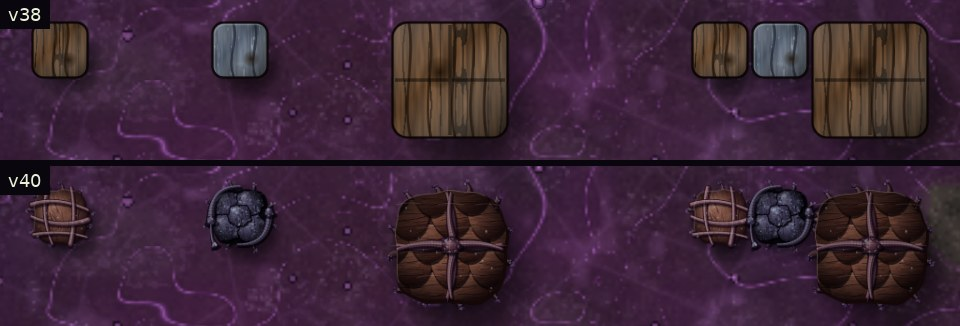

Zoom 2.5×. Top: v38 (the previous plank and slate look). Bottom: v40. Left to right: Bark Wall, Ironbark, Great Bark, then the three side by side.

## What was inspected first

Before painting, the code was read for everything the game keeps about a wall:

- **Definitions** (`B`): Bark Wall `wall` (1×1, 340 health, 6 copper), Great Bark `wallL` (2×2, 1400 health, 24 copper), Ironbark `twall` (1×1, 560 health, 6 titanium). All are `solid` and `wall:true`. Great Bark needs Bark Wall researched and Ironbark needs Great Bark.
- **Health:** `b.hp` and `b.max` (the type's health when placed), both saved with every other block field by `snapGame`. `hurtBlock` is the only thing that lowers it; it also sets `b.hit` to 0.12 s, which drives the game's white flash. At 0 the wall is destroyed. A powered Healing Pod raises every growth within 6 tiles by 12% of its maximum every 2 s of powered time.
- **Nothing else:** walls have no store, timer, power use or animation state. The game does not record where a hit came from.
- **Drawing:** `drawBlock` tries painted art first, then the HD sprite (`barkBase`, the plank and slate look), then the procedural organic look, then the classic look. The white flash, health bar, build fade and selection box are drawn for every building afterwards. The minimap has its own colours.
- **Who else uses walls:** the HDF builds `wall`, `twall` and `wallL` (its own colony look, `plateSprite`). The Test Range arenas are ringed with unbreakable Ironbark. Bombers ignore walls and turrets rank them last. Story events count HDF walls. None of this was touched.

So the only real signals are health going down (a hit, and how hard), health going up (a Healing Pod), and the health level itself. The art uses exactly those.

## The three walls

- **Bark Wall:** light and quick to grow. Soft umber bark tissue whose grain flows round two knots, with five living roots woven over and under each other through it, each bending its own way and diving under at the edge. Short root feet grip the ground.
- **Great Bark:** thick bark plates overlapping like shingles with deep shadows between, bound by two great twisted root bundles that knot in the middle, with heavy buttress roots. Darker and heavier, with the strongest silhouette.
- **Ironbark:** five domed plates pressed tightly together, near black with a violet cast and flecked with pale mineral grit, gripped round two corners by hardened, knotted roots. It reads as dense and durable but grown: no straight lines, rivets or metallic shine.
- **Joined walls:** a wall knits a bundle of twisting roots across every edge it shares with another wall or gate of ours, so a run of walls reads as one hedge. Other growths and HDF walls get no bundle.

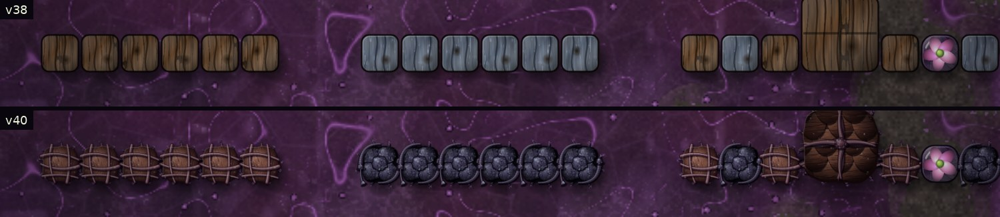
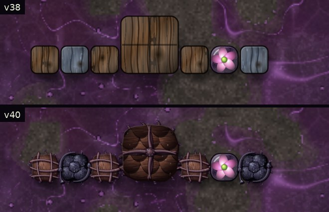
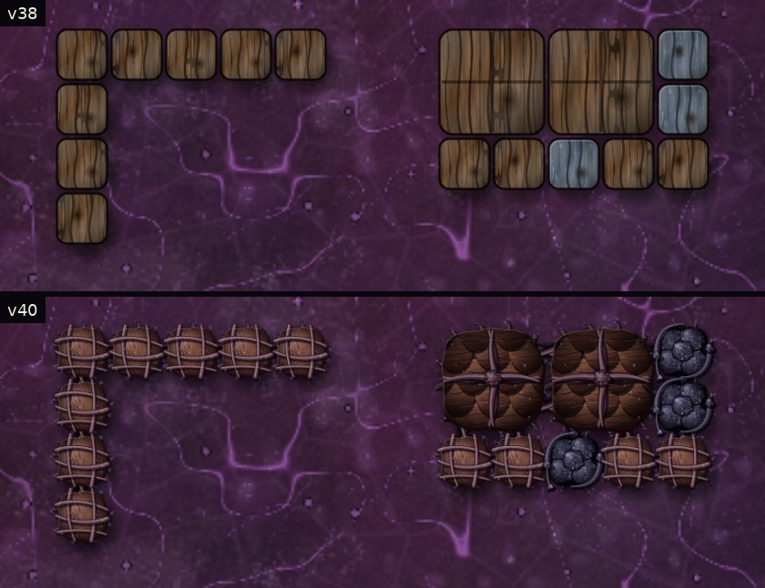
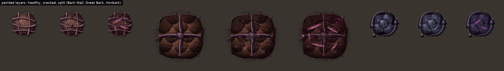

## How each wall responds to the game

Every reaction comes from a real change in health, worked out each frame the wall is drawn and remembered outside the block (in `OST`), so nothing reaches a save:

- **A hit** (health lower than the last frame drawn): the wall flinches inward and springs back in 0.34 s (Bark Wall up to 7%, Great Bark 4.5%, Ironbark 3.5%, scaled by how hard the hit was) and a bead of sap wells up and runs a little way down over 1.1 s. The game's white flash and health bar are unchanged.
- **Health level:** below 92% the bark cracks, with beads of sap in the cracks. Below 55% deep splits open to raw, wet tissue, bark is torn back and a root snaps. A hurt wall sags up to 4%, and below 35% the raw tissue throbs faintly. As a Healing Pod restores it the wounds close again. The wound look changes in steps of 5% of health.
- **Mended** (health higher than the last frame drawn): pale green healing light runs along its roots and fades over 0.9 s.
- **Idle:** a healthy Bark Wall breathes by 0.6% every 6.2 s, Great Bark 0.4%, Ironbark not at all. Nothing else moves.
- **Not a hit:** the white flash on its own, or a drop in health while the wall was out of view (or not drawn for 0.3 s), starts no reaction; the wall simply shows its current health. Loading a save with hurt walls shows them torn without a false flinch.

**A hit** (frames from the game canvas every 2 steps, from the frame health drops by 4%):

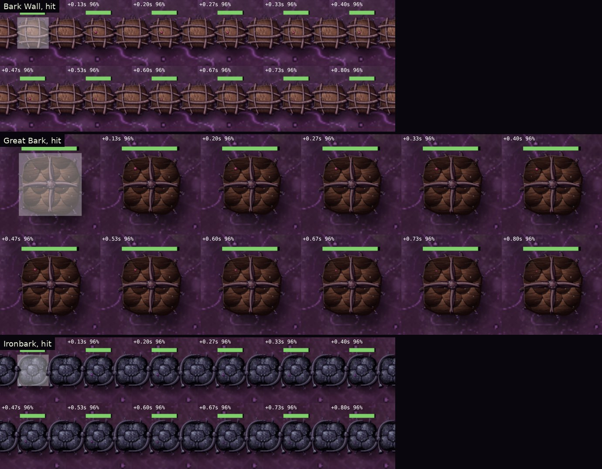

**Mended by a powered Healing Pod** (from the frame its health rises):

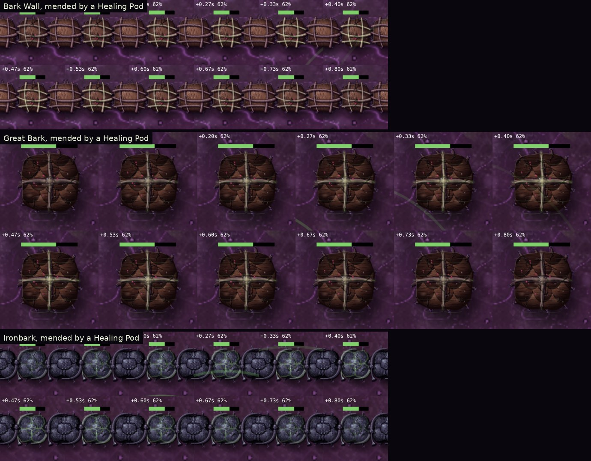

**Worn down** from full health to 10%, each frame after the reaction has passed:

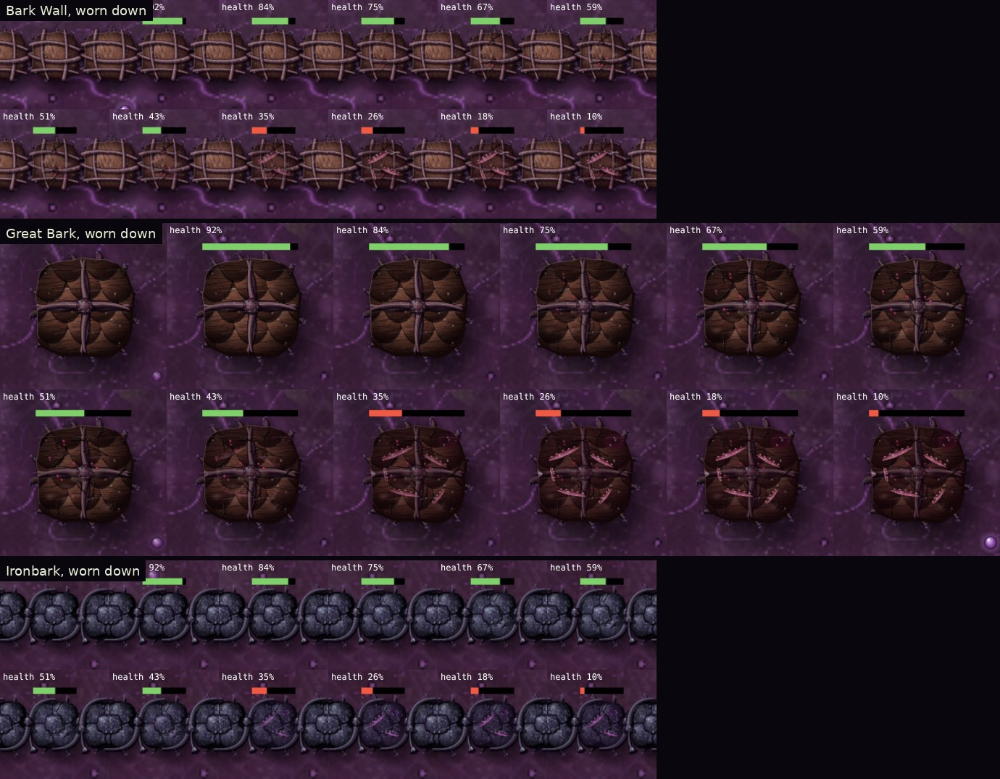

**Normal and damaged** at 80%, 50% and 20% health, previous look above:

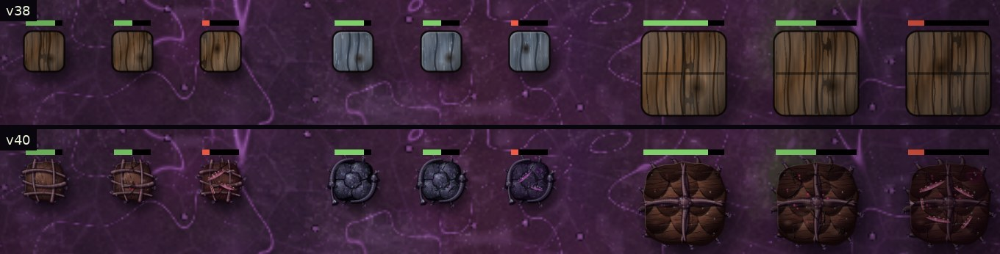

## Established colony

The v38 test colony walled in: Bark Wall runs with Great Bark corners, an Ironbark front facing the spawn with a Petal Gate, and two Healing Pods. A real wave then attacks. In both builds the wave breaks the gate and leaves one Ironbark badly hurt (the same outcome, from the same simulation). High preset, zoom 1.6× and 1×.

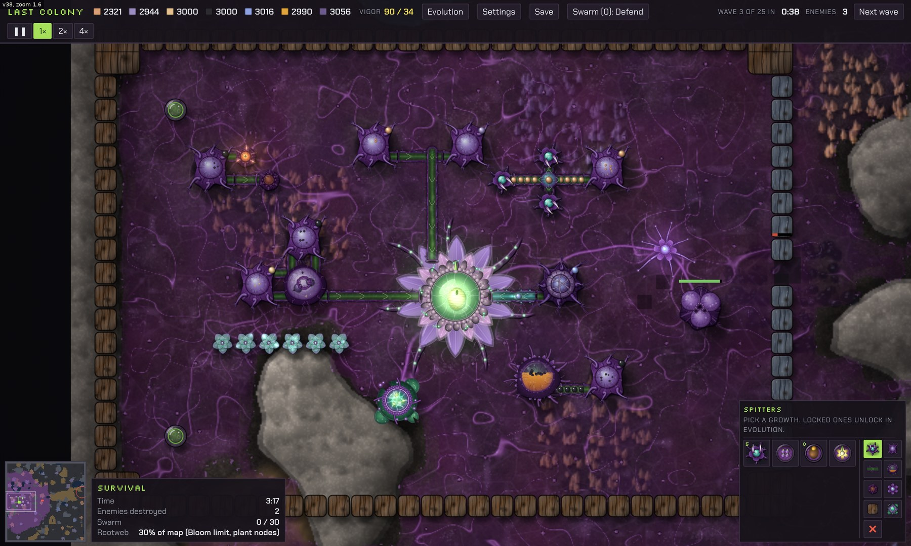
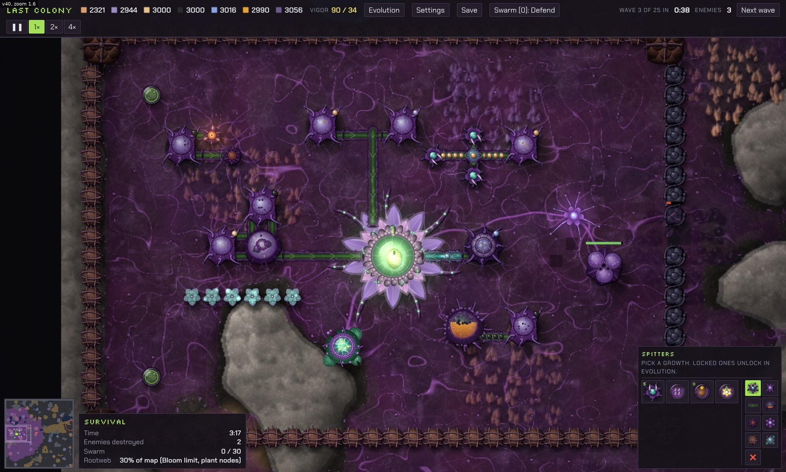
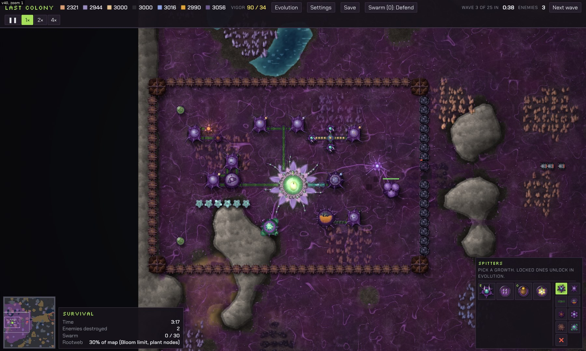

## Zoom, crowds, presets and fallback

Zoomed out past 0.75×, or with more than 140 Bark Walls, 140 Ironbark or 48 Great Bark on screen, each kind draws the same cached body picture without motion, so damage still reads in a crowd and from far away. Root feet and joining bundles are one cached picture per set of neighbours at every zoom. Low quality and painted art off give the previous look, and so does a missing image.

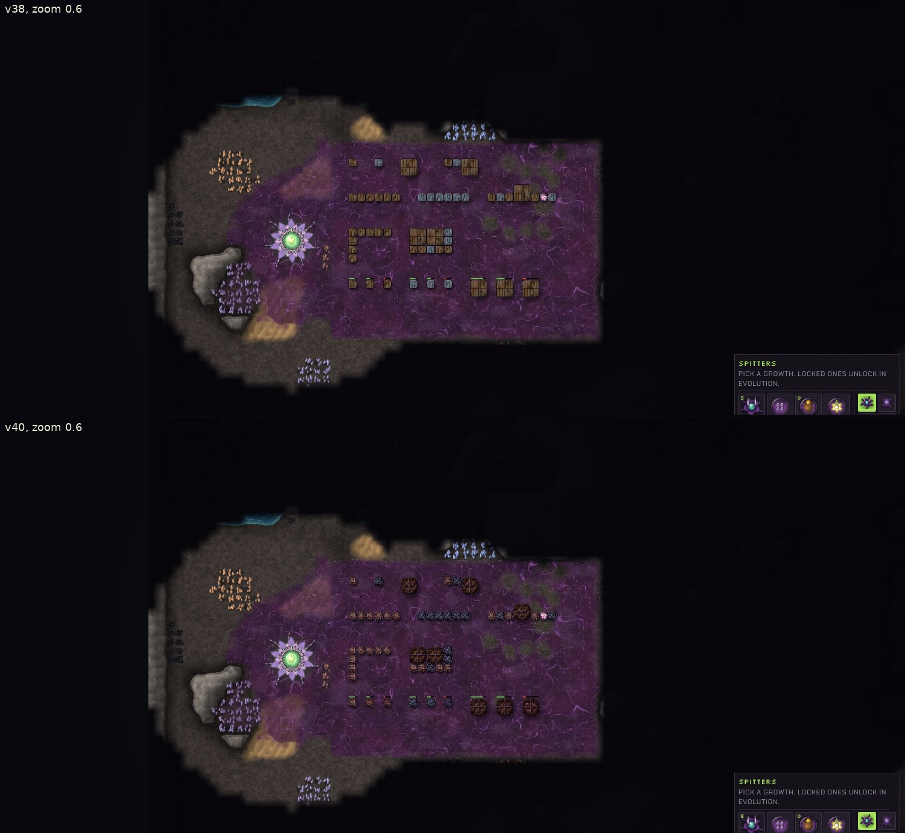
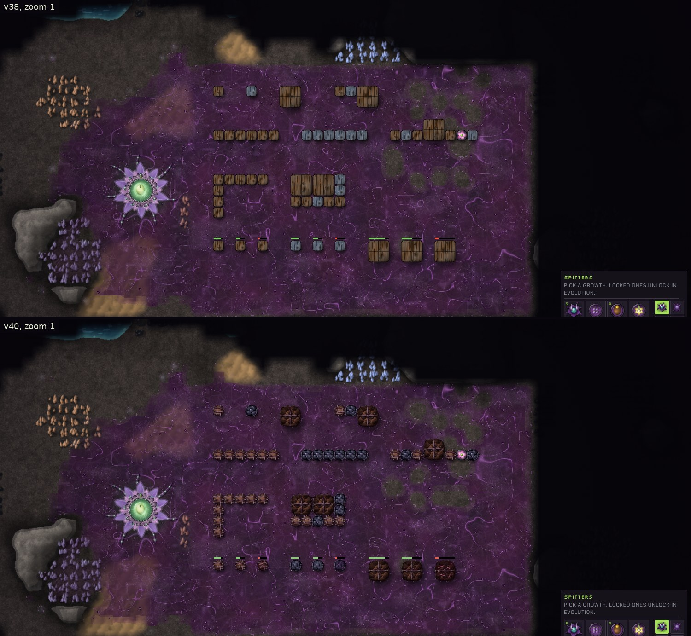
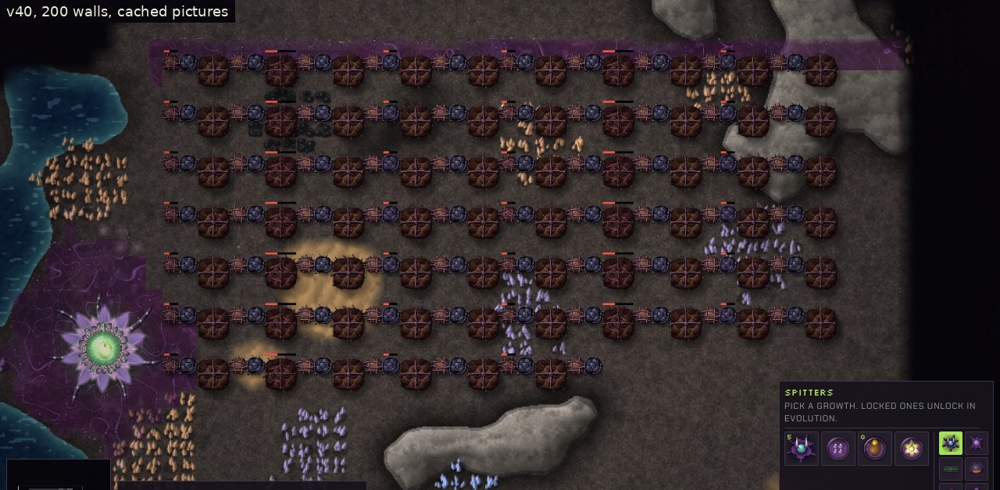
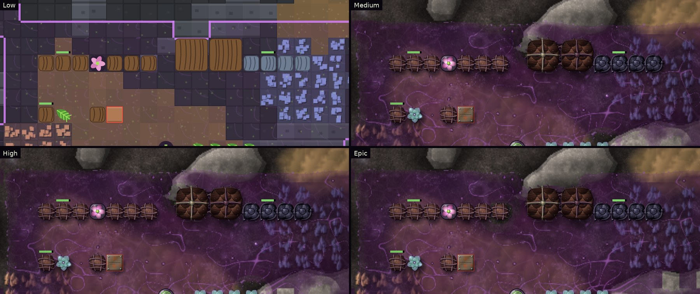
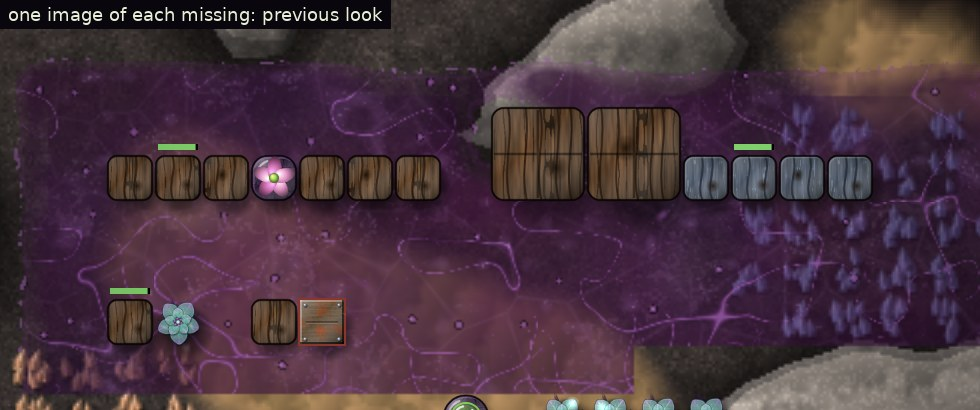

## Performance

Measured with `xperf40.js` in headless Chromium on Medium (software drawing, so a real browser with a GPU is faster), everything in view at 0.9× zoom with the walls laid in joined rows. Each time is the whole frame's `render()` plus reading one pixel back from the canvas, which makes the canvas finish its drawing inside the timed span. Without that read-back, headless Chromium saves up several frames and draws them all in one slow frame every few frames, which makes means jump about by several milliseconds from run to run in both builds. The v38 reports were measured without it, so their numbers are not comparable with these.

| On screen | v38 median | v40 median | v38 mean | v40 mean |
| --- | --- | --- | --- | --- |
| 50 Bark Walls | 12.2 ms | 13.6 ms (full motion) | 12.4 ms | 14.4 ms |
| 100 Bark Walls | 13.3 ms | 15.2 ms (full motion) | 13.4 ms | 16.3 ms |
| 200 Bark Walls | 14.9 ms | 16.6 ms (Bark Walls cached) | 15.4 ms | 17.6 ms |
| 50 Ironbark | 13.5 ms | 13.3 ms (full motion) | 14.2 ms | 13.8 ms |
| 100 Ironbark | 14.1 ms | 14.7 ms (full motion) | 15.5 ms | 15.1 ms |
| 200 Ironbark | 14.7 ms | 16.4 ms (Ironbark cached) | 16.0 ms | 17.6 ms |
| 50 Great Bark | 13.8 ms | 14.3 ms (Great Bark cached) | 15.0 ms | 14.7 ms |
| 100 Great Bark | 14.9 ms | 16.8 ms (Great Bark cached) | 15.6 ms | 17.4 ms |
| 200 Great Bark | 17.5 ms | 20.4 ms (Great Bark cached) | 19.3 ms | 21.2 ms |
| 50 mixed | 13.3 ms | 13.7 ms (full motion) | 14.0 ms | 14.2 ms |
| 100 mixed | 13.2 ms | 15.2 ms (full motion) | 13.5 ms | 15.8 ms |
| 200 mixed | 18.3 ms | 16.6 ms (Great Bark cached) | 19.8 ms | 17.2 ms |
| 50 mixed, hurt and being hit | 13.1 ms | 13.9 ms (full motion) | 13.4 ms | 14.2 ms |
| 100 mixed, hurt and being hit | 14.0 ms | 16.6 ms (full motion) | 14.3 ms | 18.4 ms |
| 200 mixed, hurt and being hit | 15.4 ms | 19.4 ms (Great Bark cached) | 15.7 ms | 21.2 ms |

In typical use (50 to 200 walls in view) the painted walls add about 0.5 to 2 ms to a frame, roughly 0.01 ms per wall. The heaviest case, 200 walls all hurt with one being hit every 0.2 s, adds about 4 ms. Ironbark costs about the same as before. Results vary by 1 to 2 ms between runs (200 mixed walls happened to measure faster than v38).

## Tests

| Check | Result |
| --- | --- |
| `ident40.js`: a walled colony (Bark Wall runs, Great Bark corners, an Ironbark front, a Healing Pod) in v38 and v40, drawn every other step with art on, through a wave that hurts walls while the pod mends them | byte-identical saves on Medium and Epic |
| `xtest40.js` | 42 of 42 |
| Test Range arena fighting, 40 s | every building's health, every enemy and every store identical to v38 |
| Flinches against real hits | one flinch per real drop in health (Great Bark 63 of 63, others 7 of 7 and 35 of 35); none from the white flash alone, none for hits while off screen, none on loading a save with hurt walls |
| Survival walls hurt on a schedule and mended by a Healing Pod | 10 of 10 hits flinch, 10 of 10 repairs glow green |
| Wound stages, joins, idle breathing | cracks and splits follow health; joins only to our own walls and gates; Bark Wall breathes, Ironbark does not |
| Zoom 0.5× to 2.5×, crowds of up to 200, art on and off | no page errors; cached picture zoomed out and past the crowd limits; hit flash and health bars unchanged |
| Missing PNG (one per wall) | each wall falls back to its previous look with one console warning; the others stay painted |
| Low, Medium, High, Epic | Low uses the previous look, the others the painted art; no page errors |
| Save and load | the saved fields are the same set v38 saves; a v40 save loads in v38 and a v38 save loads in v40 |
| Windows app (`elcheck40.js`, Electron) | loads all three painted walls from its own files (state `ready`), no errors |
| Full regression suite (30 suites, `tests/README.md`) | see below |

**Regression suite.** Every suite ran on the final build:

- **Passed with no failures:** lcquick, lcskir, lcstory, lcheld, lcsave, lctest, lcart, lcbloom, lcweb, lchd, qtest, otest, vtest, ncheck, nstory, gpuapp, mtest, oldsave, btest, dtest (WebGL), ident37, xtest37, ident38, xtest38, ident40 and xtest40. Their logs count a few "fail" words, but each one is a PASS line about the missing-image fallback ("state":"failed") or a test name, not a failed check. The same lines are in the v38 logs.
- **Known failure from before v40, not new:** `wbtest` with WebGL 2, check 11 "30% coverage performance". This is the headless Chromium software-WebGL timing check: the first frame after switching on WebGL took 222 ms against its limit (v38's run: 199 ms). It fails the same way on v38 and does not involve the walls.
- **Crashed once, not reproduced:** `lcspit` (Thorn Spitter) crashed in its own setup because one spitter was not placed, and `dtest` without WebGL crashed in its own setup when a test Node was not placed. Neither got as far as drawing a wall. Both tests let the game run in real time between steps, so their scenes vary from run to run. Rerun three times each on v38 and v40, both passed every time on both builds (lcspit all checks, dtest 12 of 12), so these are not counted as v40 regressions.

## Save compatibility

No fields were added to blocks or to the game state. All visual memory lives in a `WeakMap` keyed by the block and is never saved. `xtest40.js` checks that the saved fields of every wall are the same set v38 saves, that a v40 save loads and plays in v38, and that a v38 save with hurt walls loads in v40 and draws them torn by their saved health without a false reaction. `ident40.js` checks that the whole save after a wave is byte-identical between v38 and v40. `oldsave.js` in the regression suite loads older saves.

## Files

- `index.html`: the game. New: the `DW` table, the `wall`, `wallL` and `twall` entries in `ART.plant`, `drawWall`, `drawWallUnder`, `wLinks`; the crowd limits for the three walls.
- `art/plant/bark-wall/`, `art/plant/great-bark/`, `art/plant/ironbark/`: eight PNG layers each (24 in all).
- `art/source/paint_defense.js`: the painter that makes them.
- `art/ART-GUIDE.md`: new section *Painted defensive organs (v40)*.
- `tests/ident40.js`, `tests/xtest40.js`, `tests/xperf40.js`, `tests/xscene40.js`, `tests/xanim40.js`, `tests/xcolony40.js`, and their rows in `tests/README.md`.
- `docs/v40-defense-art.md` (this report), `docs/screenshots/v40/`, the wall lines in `docs/Last-Colony-Game-Guide.txt`, `.gitignore` (`/shots40/`).

## Known limitations

- The game does not record where a hit came from, so the sap shows at a spot chosen from the wall and its hit count, not on the side facing the attacker.
- Several hits landing between two drawn frames show as one flinch, sized by their total.
- Petal Gate and Maw Gate keep their previous look (they were not in this task). Walls knit their bundles into a gate, but the gate sends none back.
- HDF walls keep their colony look; only the hive's walls are painted.
- The rendering times are from headless Chromium with software drawing; a real browser with a GPU is faster.
