# v41: painted Petal Gate, Maw Gate and Healing Pod

The hive's two gates and its Healing Pod are now painted in the same wet, organic style as the walls painted in v40. This is artwork and visual feedback only. Passage rules, collision, pathing, healing amount, healing radius (6 tiles), healing interval, vigor use, costs, health, the HDF's gates, the campaign, the AI and the save format are unchanged. How it is drawn is in [art/ART-GUIDE.md](../art/ART-GUIDE.md), section *Painted gates and Healing Pod (v41)*.

The brief was titled "v40"; v40 was already used for the walls, so this release is v41.

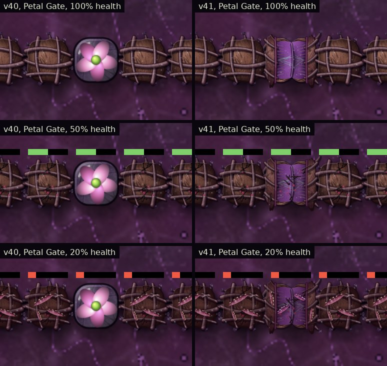

Zoom 4×. Left: v40 (the previous look). Right: v41.

## What was inspected first

- **Definitions** (`B`): Petal Gate `door` (1×1, 300 health, 10 copper and 6 Bark), Maw Gate `doorL` (2×2, 1300 health, 40 copper, 24 Bark and 6 graphite), Healing Pod `mender` (1×1, 90 health, 30 Bark and 1 silicon, 12 vigor). Gates are `solid` and `wall:true`.
- **Who passes a gate:** `solidFor(team,b)` makes a gate open ground for its own team's units and solid for everyone else. It does not look at the unit's kind.
- **Open state:** `gateOpen(b,t)` checks whether any of the gate's own units is within half its size plus 1.4 tiles of its centre and eases `b.op` towards 1 or 0 by 18% per call. It is called once per drawn frame and `b.op` is saved. It is purely visual in the game: passage never reads it.
- **Healing Pod:** while it has vigor, every 2 s of powered time it raises every damaged growth of ours within 6 tiles (centre to centre) by 12% of that growth's maximum, and if it mended anything the game adds a short `heal` effect at the pod. Its 12 vigor is only drawn while some growth of ours is damaged.

So the gates' only real signal is `gateOpen`'s open amount, and the pod's are its heal effect and the health of what it mends. The art uses exactly those.

### Finding: Bulwark Ants pass Petal Gates

The Petal Gate's description says "Too narrow for Bulwark Ants", but nothing in the simulation enforces that: `solidFor` lets any of our units through, and a Bulwark (radius 0.55) is treated as radius 0.42 for collision, which fits a one-tile gap. `gpass41.js` and `xtest41.js` both walk a Bulwark through a Petal Gate in a sealed pen and it crosses (6.4 s in `gpass41.js`). The brief asked for the art to follow the simulation and not to change passage rules, so the Petal Gate opens for a Bulwark like any other ant and the description text is unchanged. Either making the rule real or correcting the text is a separate decision.

## The three structures

- **Petal Gate:** two thick bark jambs carrying on from the walls either side, lined with pale living tissue, and two overlapping fleshy petals meeting over the passage with a visible seam, contractile fibres, veins and a translucent edge. Root feet grip the ground under the jambs only, so nothing covers the passage. In a vertical wall line it is drawn turned so its petals still part across the line.
- **Maw Gate:** a muscular aperture, not a bigger Petal Gate and not a mouth. A ring of sphincter fibres and sixteen cellulose ribs, bark plates at the corners and thick root bundles, holding six overlapping reinforced membranes that close like an iris over a dark throat (a small pinhole stays at the very centre, like a shut sphincter). The throat is 0.78 tiles in radius, so a Bulwark visibly fits.
- **Healing Pod:** a translucent waterlily-like organ: a ring of pale lilac petals round a glossy chamber of pale green sap with drifting motes and faint vascular channels. It is lighter and calmer than the Seed Pod and Resin Gland, and is drawn a quarter larger than painted so it fills its tile like the previous pod.
- **Joined to the walls:** both gates knit root bundles into neighbouring walls and gates of ours (the Maw two per side), and the walls already knit theirs into the gates (v40), so a line with gates reads as one hedge.

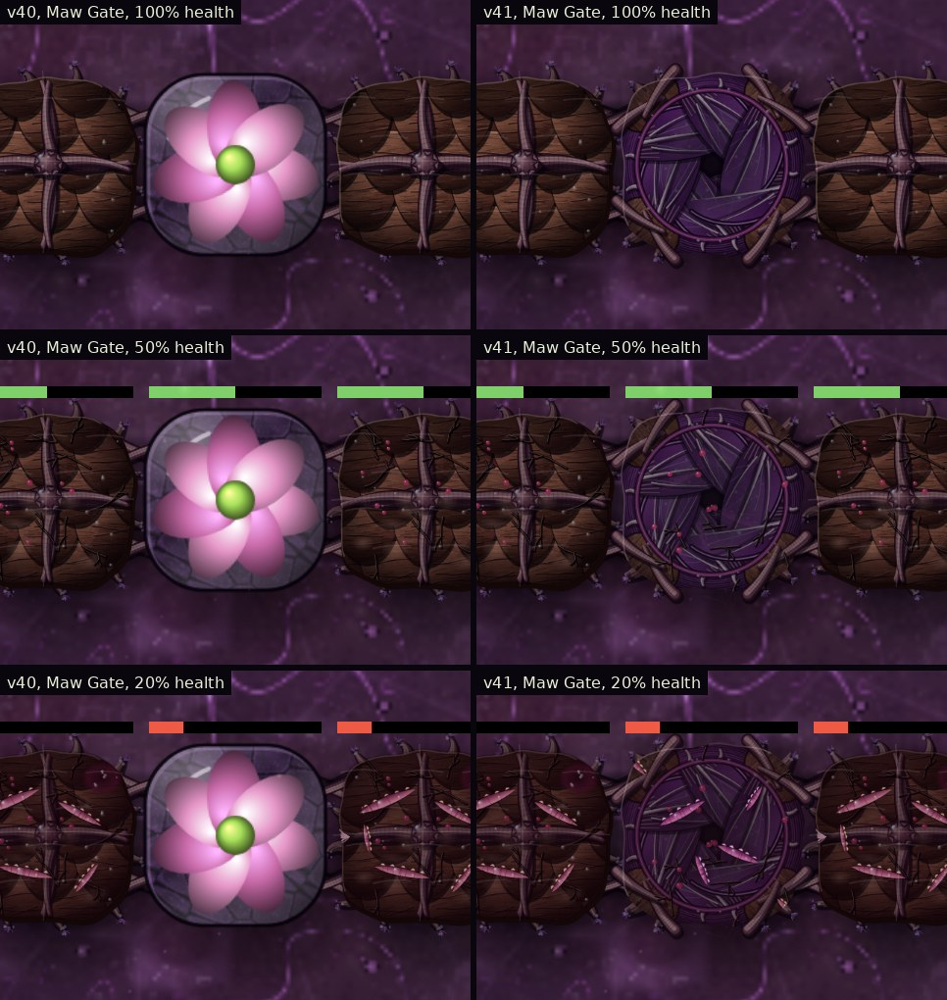
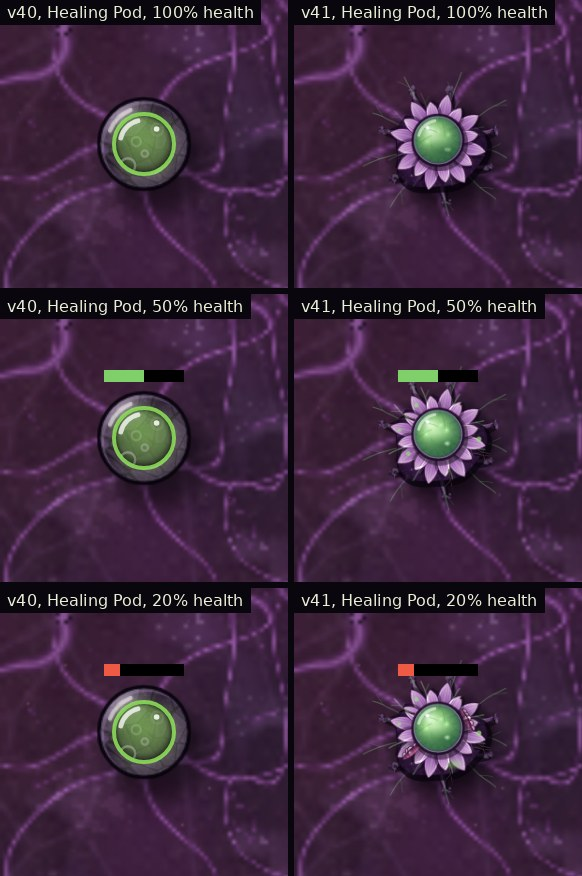
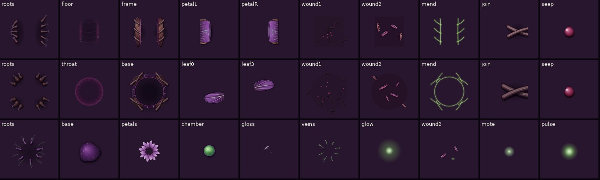

## How they respond to the game

- **Opening:** the drawing calls the game's own `gateOpen` once per frame, exactly as v40 did, and draws its open amount. There is no second decision: the petals part and the membranes rotate open only as far as `b.op` says. Petal Gate: the seam first tightens slightly, then the two petals fold back against the jambs and the dark passage clears. Maw Gate: the ring first pinches slightly, then the six membranes rotate and draw back into the ring like an iris until the throat is clear. Closing is the same in reverse. The timing is the game's (about 0.2 s at 60 frames a second). Units are drawn above buildings, and the checks show the open amount is above 0.9 on every frame an ant overlaps a gate, so a closed petal is never drawn over a passing ant.
- **Hit, damage, mend:** as on the walls. A real drop in health makes the gate or pod flinch (Petal 6%, Maw 4%, pod 6%) and draws a bead of sap. Below 92% health the tissue cracks, below 55% it splits. A Healing Pod repair plays the v40 mend light on gates as on walls.
- **Healing Pod at rest:** the chamber breathes by 1.5% every 5.2 s and its motes drift. Veins and glow stay faint.
- **Healing Pod repairing** (only when the game really mends something): the chamber swells slightly as the next repair comes due, then on the frame the game adds its heal effect it squeezes, its veins and glow brighten, and a pulse of sap runs along an arc to each growth it mended (up to the 8 nearest, only those whose health actually rose). Growths other than walls and gates get a soft glow on arrival; walls and gates already show their own v40 mend light, so nothing bright is stacked. It then eases back to rest. The game's own range ring and heal ring are unchanged.
- **No vigor, nothing damaged:** no active look and no pumping. The game repairs nothing, so nothing plays.

**Petal Gate opening and closing,** every drawn step with a Mite Ant, open amount from the game:

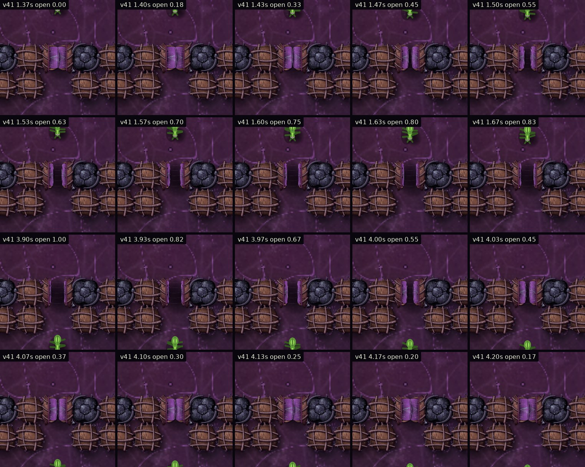

**Maw Gate opening and closing** for a Bulwark Ant:

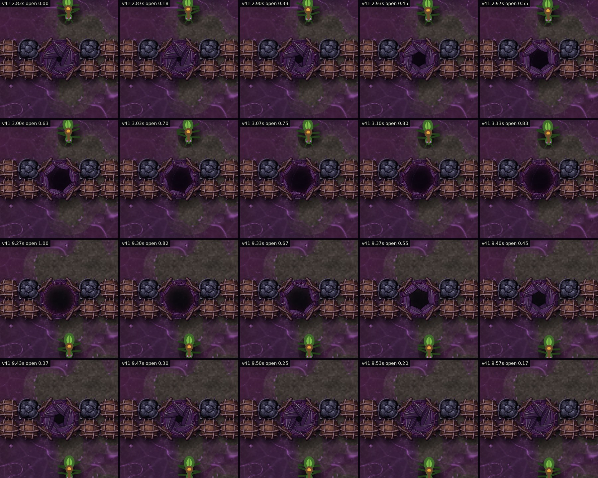

**A Bulwark Ant through the Maw Gate:**

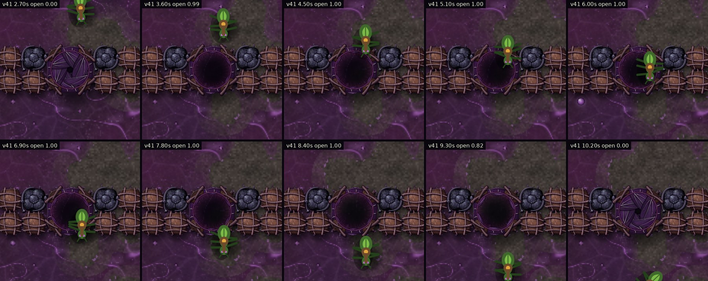

**A Thornback and a Bulwark through a Petal Gate:**

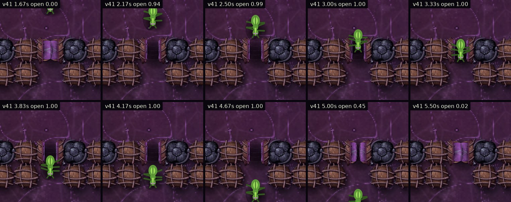
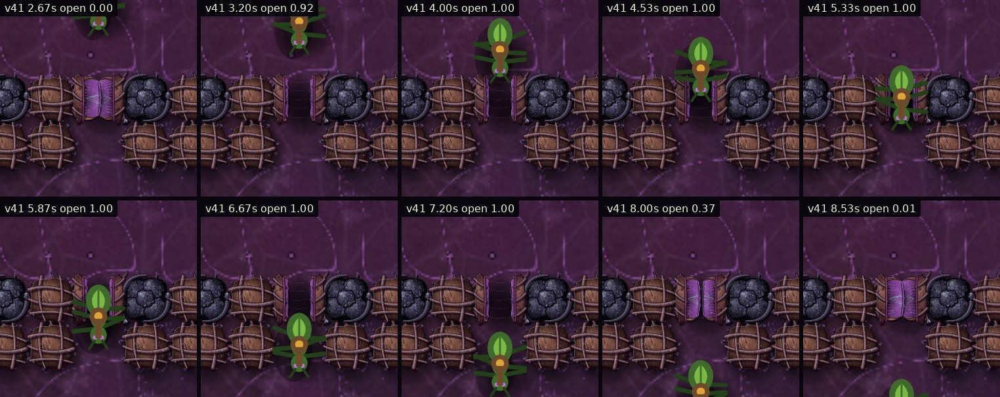

**The Healing Pod repairing the hurt line,** from the frame the game makes a repair:

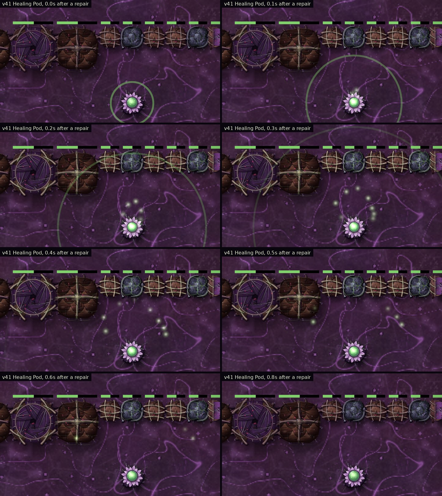

The previous look for each sequence is in `screenshots/v41/` with `_v40` in the name.

## A defensive line

Bark Wall and Ironbark with two Petal Gates, a Maw Gate between two Great Barks, and three Healing Pods behind it on Sunleaves. A Mite Ant stands in the left Petal Gate and a Bulwark in the Maw Gate, so both are drawn open; some sections are hurt.

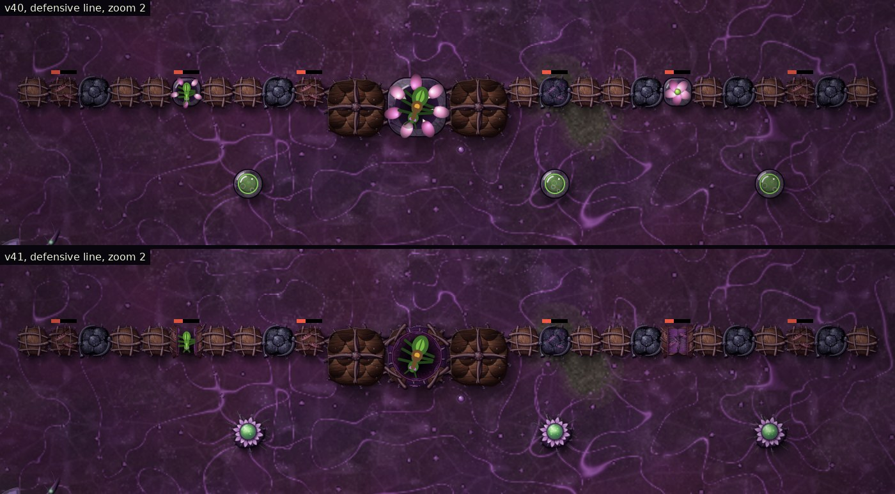
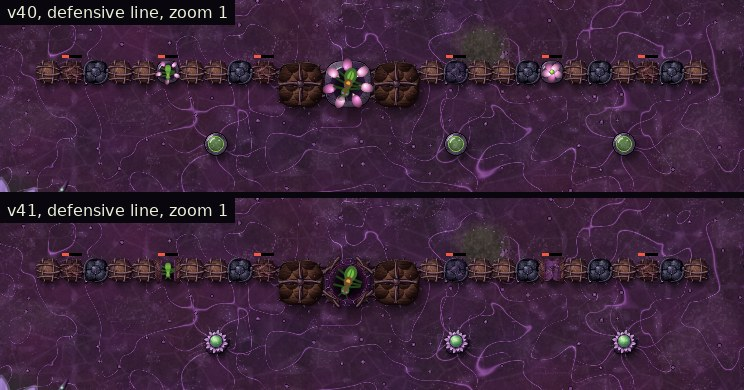
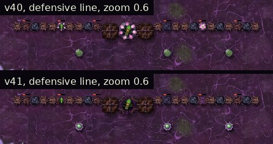

## Zoom, crowds, presets and fallback

Zoomed out past 0.75×, or with more than 80 Petal Gates, 30 Maw Gates or 40 Healing Pods on screen, that kind is drawn without motion (no flinch, breathing or sap pulses), but a gate still opens and closes with the game. Low quality and painted art off give the previous look, and so does a missing image.

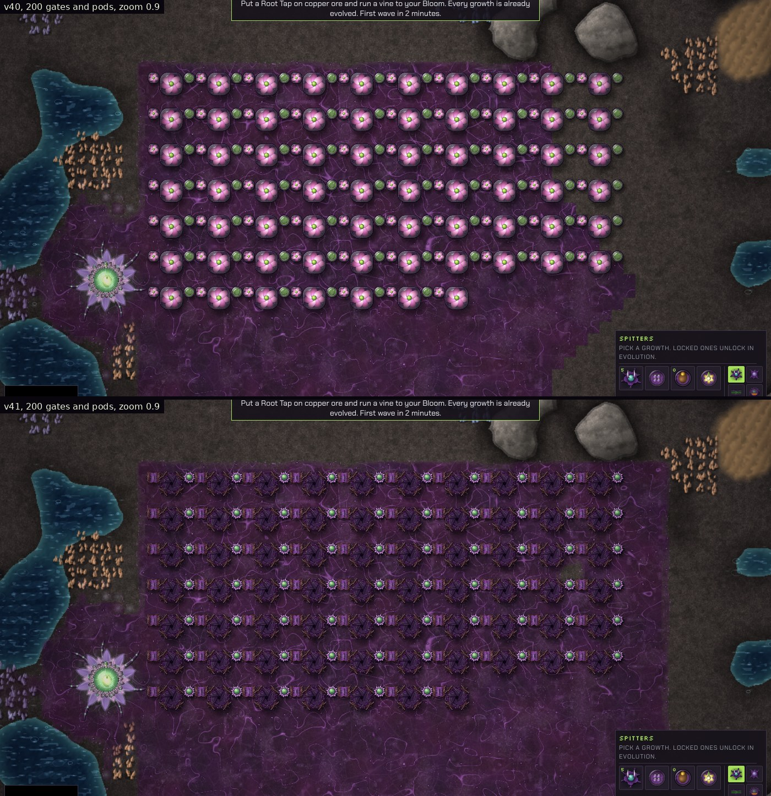
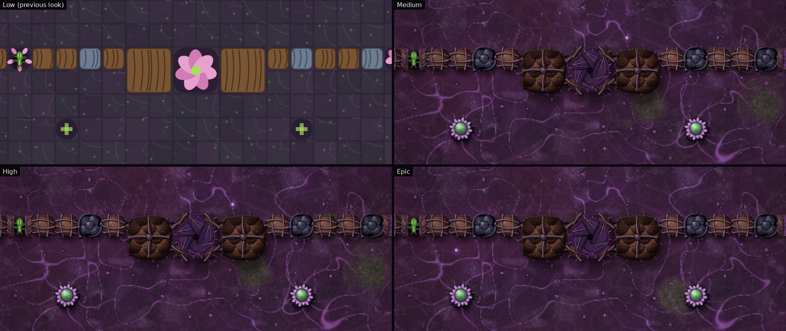
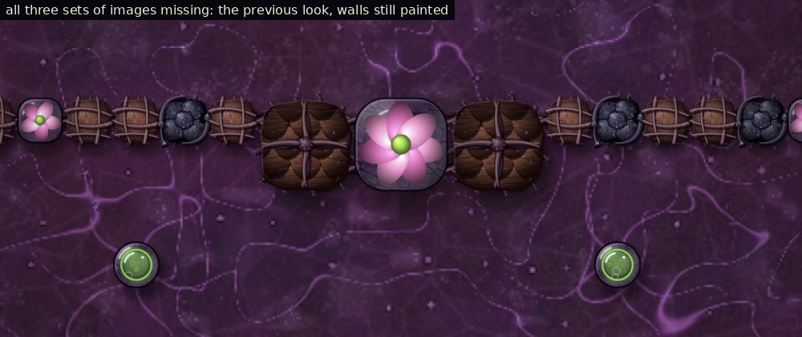

## Performance

Measured with `xperf41.js` in headless Chromium (software drawing, so a real browser with a GPU is faster), everything in view at 0.9× zoom. Each time is one `render()` plus reading one pixel back so the canvas finishes drawing inside the timed span. "Active" is the mixed set with every structure at 40% health, an ant held in every fourth gate, the pods repairing and one structure in five being hit each second.

Medium:

| On screen | v40 median | v41 median | v40 mean | v41 mean |
| --- | --- | --- | --- | --- |
| 50 Petal Gates | 16.2 ms | 15.2 ms | 17.7 ms | 15.8 ms |
| 100 Petal Gates | 17.8 ms | 16.6 ms (cached) | 18.6 ms | 17.0 ms |
| 200 Petal Gates | 23.4 ms | 21.3 ms (cached) | 25.6 ms | 23.9 ms |
| 50 Maw Gates | 18.7 ms | 18.9 ms (cached) | 20.1 ms | 20.0 ms |
| 100 Maw Gates | 24.4 ms | 24.4 ms (cached) | 27.4 ms | 25.9 ms |
| 200 Maw Gates | 36.0 ms | 35.8 ms (cached) | 39.6 ms | 37.6 ms |
| 50 Healing Pods | 18.0 ms | 14.9 ms (cached) | 19.7 ms | 16.0 ms |
| 100 Healing Pods | 20.3 ms | 17.9 ms (cached) | 21.7 ms | 18.7 ms |
| 200 Healing Pods | 28.5 ms | 23.2 ms (cached) | 30.5 ms | 24.0 ms |
| 50 mixed | 17.4 ms | 16.2 ms | 17.7 ms | 16.4 ms |
| 100 mixed | 22.0 ms | 20.0 ms | 23.2 ms | 20.6 ms |
| 200 mixed | 29.4 ms | 27.2 ms | 31.5 ms | 30.8 ms |
| 50 active | 19.3 ms | 17.7 ms | 21.2 ms | 18.5 ms |
| 100 active | 22.3 ms | 21.6 ms | 23.0 ms | 22.8 ms |
| 200 active | 36.0 ms | 29.9 ms | 39.7 ms | 31.1 ms |

On Epic (50 and 200 of each), at 50 v41 was within 0.6 ms of v40 (pods 3 ms faster), and at 200 it was 1.7 to 4.5 ms faster. At 2.5× zoom with 50 of each, v41 was within 1 ms of v40. The painted versions cost the same as or less than the previous procedural look (probably because that look built its petals and pod from many canvas paths every frame, where the painted one draws a few cached pictures). Results vary by 1 to 2 ms between runs.

## Tests

| Check | Result |
| --- | --- |
| `xtest41.js` (10 checks for each structure, plus HDF, art toggle, presets, crowds, missing PNG, cross-build saves, page errors) | 41 of 41 |
| `ident41.js`: a walled colony with Petal Gates, a Maw Gate and a Healing Pod through a wave, ants walking through the gates, drawn every other step: v40 against v41, v41 art off against on, and v40 art off against v41 art on | byte-identical saves on Low, Medium and Epic (198 health drops and 16 repairs in each) |
| `gpass41.js`: which ants the simulation lets through each gate | Mite, Thornback and Bulwark through both gates, in v40 and v41 alike |
| Windows app (`elcheck41.js`, Electron) | loads all three from its own files (state `ready`, as do the walls and organs), no errors |
| Full regression suite (`tests/README.md`) | see below |

**Saves and drawing.** `b.op` is saved and `gateOpen` runs only while a gate is drawn, so a gate's saved open amount already depended on drawing in v40. v41 keeps that exactly: it calls `gateOpen` once per drawn frame in every mode, painted or not, so the saves match v40 with art on or off. Separately, `ident41.js` found that with the whole game seeded from one `Math.random`, art on and art off already gave different saves in v40: the previous procedural look takes random numbers while drawing, which shifts the simulation's later draws. The identity test gives drawing its own random source to compare like with like. This is recorded as a pre-existing property, not a v41 change.

**Regression suite.** Every suite ran once on the final build (33 runs):

- **Passed with no failures:** lcquick, lcskir, lcstory, lcheld, lcsave, lctest, lcart, lcbloom, lcweb, lchd, lcspit, qtest, otest, vtest, ncheck, nstory, gpuapp, mtest, oldsave, btest, dtest (with and without WebGL), wbtest without WebGL, ident37, xtest37 (40 of 40), ident38, xtest38 (38 of 38), ident40, xtest40 (42 of 42), ident41 (Medium and Epic) and xtest41 (41 of 41). Some logs count a "fail" word, but each one is a PASS line about the missing-image fallback ("state":"failed") or a file-not-found message that fallback test expects; the same lines are in the v40 logs.
- **Known failure from before v41, not new:** `wbtest` with WebGL 2, check 11 "30% coverage performance": the first frame after switching on WebGL took 232 ms against its limit (v40's run: 222 ms). It is headless software-WebGL timing, fails the same way on v40, and does not involve gates or pods.
- **Intermittent before v41:** in the v40 run `lcspit` and `dtest` without WebGL each crashed once in their own setup; this time both passed.

## Save compatibility

No fields were added. All visual memory (flinch, wound step, pump timing, sap pulses) lives in a `WeakMap` keyed by the block or in an unsaved list, and is never saved. `xtest41.js` checks a gate saved half open loads with the same open amount, the pod's saved fields are the same set v40 saves, and saves load across v40 and v41 in both directions.

## Files

- `index.html`: the game. New: `PETAL_LAYERS`, `MAW_LAYERS`, `POD_LAYERS`, the `door`, `doorL` and `mender` entries in `ART.plant`, the `DG` table, `drawGateP`, `drawGateM`, `drawGateUnder`, `drawPod`, `drawPodUnder`, `drawPodFx`, `podTargets`; crowd limits for the three.
- `art/plant/petal-gate/` (10 layers), `art/plant/maw-gate/` (14), `art/plant/healing-pod/` (12).
- `art/source/paint_gates.js`: the painter that makes them.
- `art/ART-GUIDE.md`: new section *Painted gates and Healing Pod (v41)*.
- `tests/ident41.js`, `tests/xtest41.js`, `tests/xperf41.js`, `tests/xshots41.js`, `tests/xanim41.js`, `tests/gpass41.js`, and their rows in `tests/README.md`.
- `docs/v41-gates-pod-art.md` (this report), `docs/screenshots/v41/`, the gate and pod lines in `docs/Last-Colony-Game-Guide.txt`, `.gitignore` (`/shots41/`).

## Known limitations

- The Petal Gate opens for Bulwark Ants because the simulation lets them through (see the finding above). Its description still says it is too narrow.
- `gateOpen` only runs while a gate is drawn (as in v40), so a gate off screen keeps its last open amount until it is next drawn. The game's passage never depends on it.
- The pod's sap pulses go to the growths whose health rose on the repair frame; a growth that is mended while out of view still gets its pulse if the pod is in view.
- HDF gates keep their colony look; only the hive's are painted.
- The rendering times are from headless Chromium with software drawing.
