# v42: painted Spore Flak, Seed Mortar, Sunlance and Brood Chamber, and the Bulwark gate rule

The last four hive structures are now painted, so all 26 are. Their artwork is visual only: footprints, costs, ammunition, vigor, damage, range, accuracy, targeting, fire rate, projectiles, splash, production times, spawn positions, health, the HDF's versions and the save format are unchanged. The one gameplay change in v42 is the Bulwark gate rule: a Bulwark Ant can no longer pass a Petal Gate and goes round to a Maw Gate or another way instead. How the four are drawn is in [art/ART-GUIDE.md](../art/ART-GUIDE.md), section *Painted weapons and Brood Chamber (v42)*.

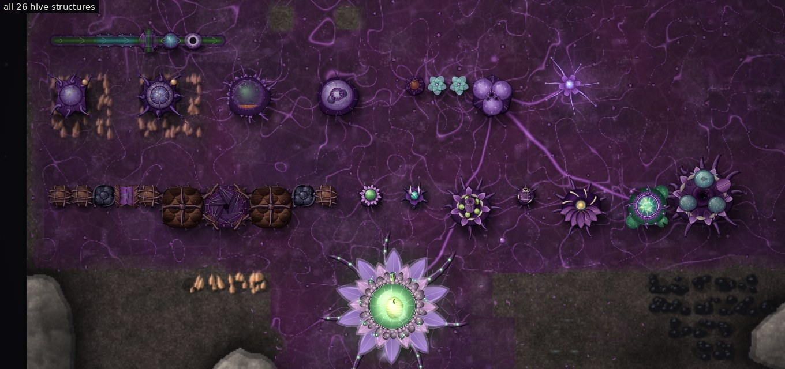

## Before and after

Zoom 4×, at full, half and low health. Left: v41 (the previous look). Right: v42.

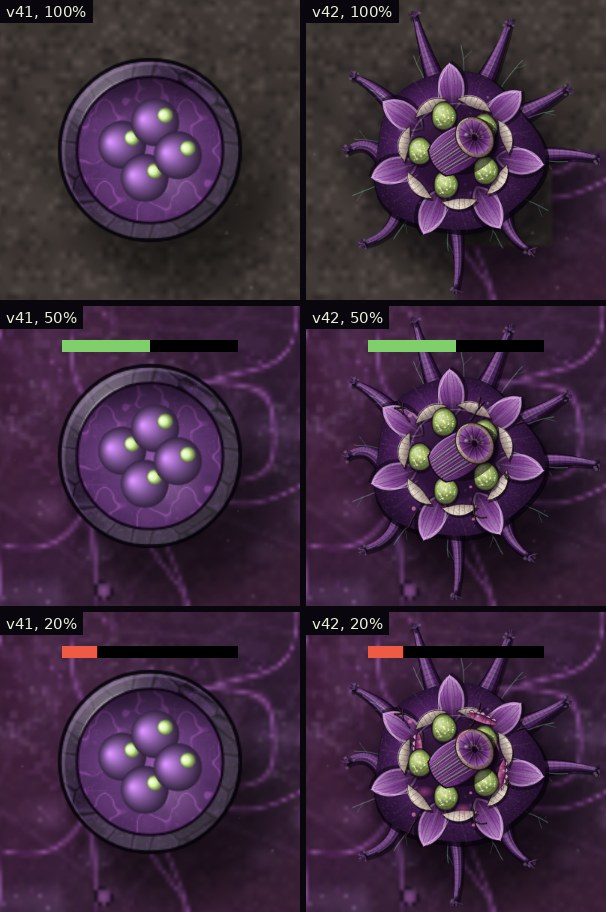
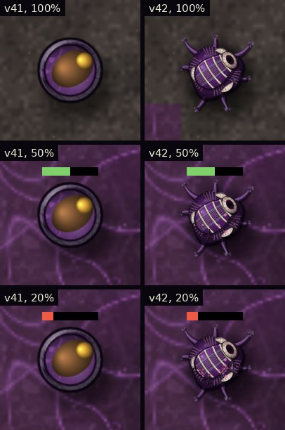
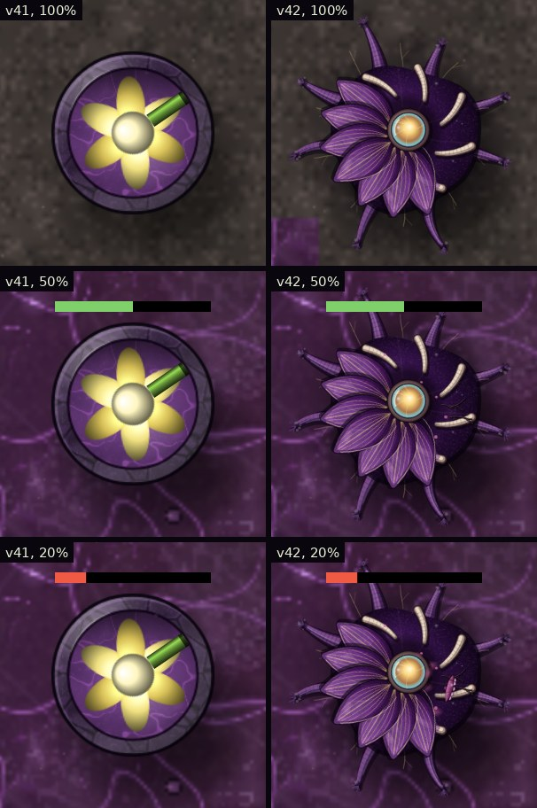
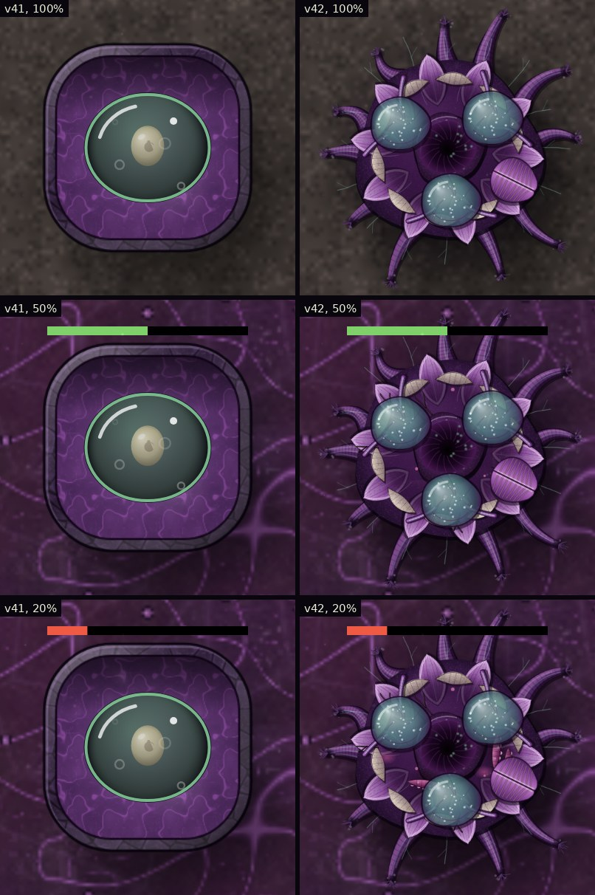

The four together at zoom 2, 1 and 0.6:

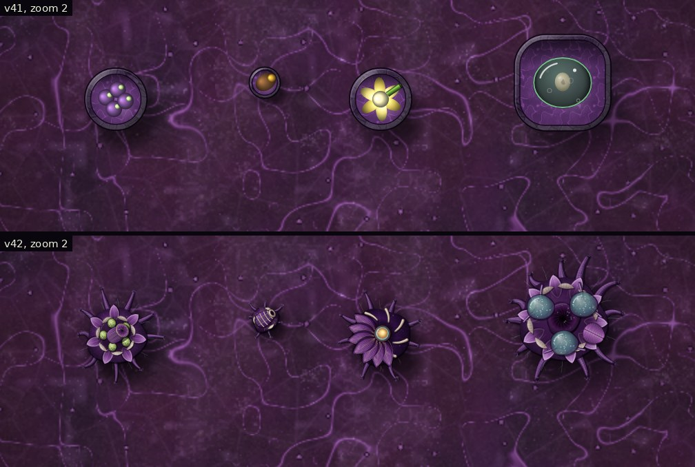
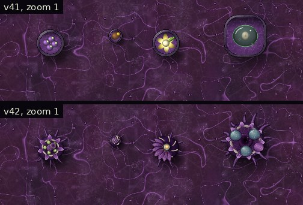
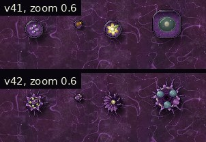

## What the game does, and what the art reads

Checked in the code before painting:

- **Spore Flak** (`scatter`, 2×2, air only) and **Seed Mortar** (`hail`, 1×1, ground only): the turret turns `b.ang` towards its target; a real shot sets `b.shot` and `b.reload` and spends one round. The Flak's bullets carry `flak`; the Mortar's carry `art` and fly an arc to the aimed point, where the game adds its `boom` effect and deals splash damage.
- **Sunlance** (`lancer`, 2×2, 40 vigor): `b.charge` rises with vigor only while it has a live target; at 1 it damages along its beam line and adds a 0.25 s `laser` effect from its centre.
- **Brood Chamber** (`factory`, 3×3, 30 vigor): `b.prog` rises with vigor while it can afford `b.unit` (Thornback or Bulwark); at 1 it pays, resets and hatches the ant on `exitTile(b)`.

The drawing reads only these. It never adds shots, beams or hatchings of its own.

## The four structures

- **Spore Flak:** a rooted lily mound holding five translucent spore sacs that feed a muscular launching neck with a membrane over its mouth. As a real shot comes due (only with a target and ammunition) the sacs tighten and the veins light. On the shot the membrane snaps shut, the neck kicks back, a puff of spores leaves the mouth, and the organ relaxes. Nothing moves during an empty cooldown. The projectile is a cluster of pale spores, and its burst replaces the orange flash.
- **Seed Mortar:** a root knot holding a thick curved chamber of dark membrane hooped with pale cellulose, a reinforced opening and the next hardened seed. The chamber draws in before a shot; on the shot the opening flares, the seed leaves (it is now the game's projectile), the chamber recoils and restores, and a new seed slides into the opening only if there is ammunition. The seed flies the game's own arc, turned along its path, and on impact its casing splits into two halves with fragments, scaled to the game's splash radius.
- **Sunlance:** a dish of seven focusing petals and a membrane fan behind a lens of luminous fluid. It gathers only while the game is charging it (a live target and vigor): the petals close, the gold veins brighten and the lens lights as far as `b.charge`. The painted beam (violet glow, gold band, white core, three pulses and a small flare at the end) is drawn only for the game's own fresh beam, from the lens along the game's beam line, for its 0.25 s. Without vigor or a target the lens stays dark and no beam is drawn.
- **Brood Chamber:** the matured Seed Pod: roots, ten petals, a central brood cavity ringed by three incubation sacs joined by nutrient vessels, and a release opening of two fleshy lips. The opening faces the tile the game would hatch onto now. While production runs, the sac in use shows the ant really being grown (a Thornback or a heavier Bulwark form, by `b.unit`), growing with `b.prog`, with nutrient pulses along its vessels. A hatching is drawn only when `prog` falls back with a fresh ant of that kind on the exit tile, so changing the order is not drawn as a hatching. Without vigor or materials nothing flows.

All four flinch on a real hit, crack and split with damage in 5% steps, play the mend light on a Healing Pod repair, and keep the game's no-ammunition dot, range ring, health bar and hit flash.

## Firing and incubation, from the game canvas

Every frame is the real simulation drawn at that step; the labels are the game's own state.

**Spore Flak** firing at a Bomber, from 0.13 s before its first real shot:

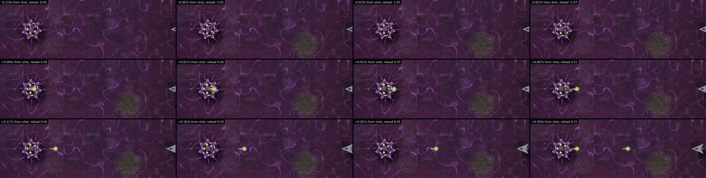

**Seed Mortar** throwing at a Flame Tank: the throw, the arc and the casing splitting:

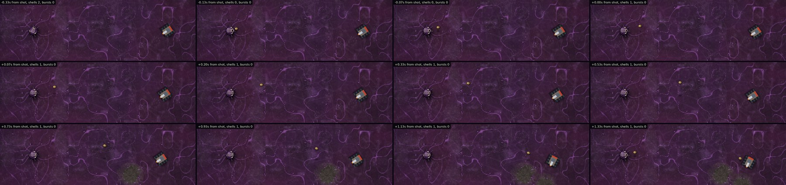

**Sunlance** gathering from the moment it has a target, the beam, and relaxing:

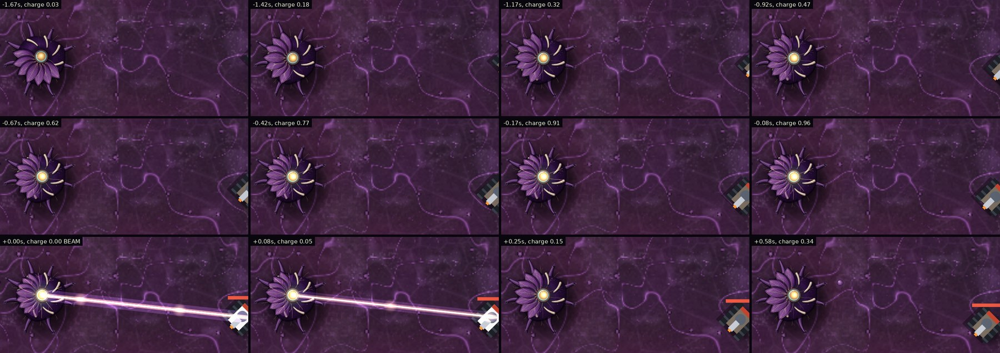

The same Sunlance with no vigor and a target in range: no gathering and no beam (the game fires none either):

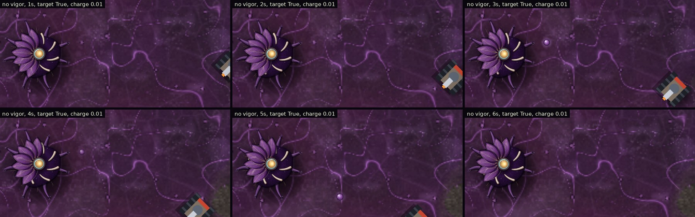

**Brood Chamber** growing and hatching a Thornback, then a Bulwark Ant (top row every 0.5 s while growing, bottom row round the hatching):

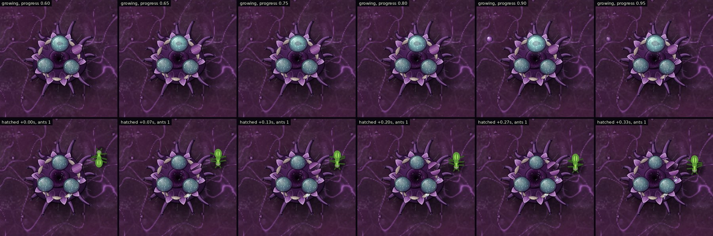
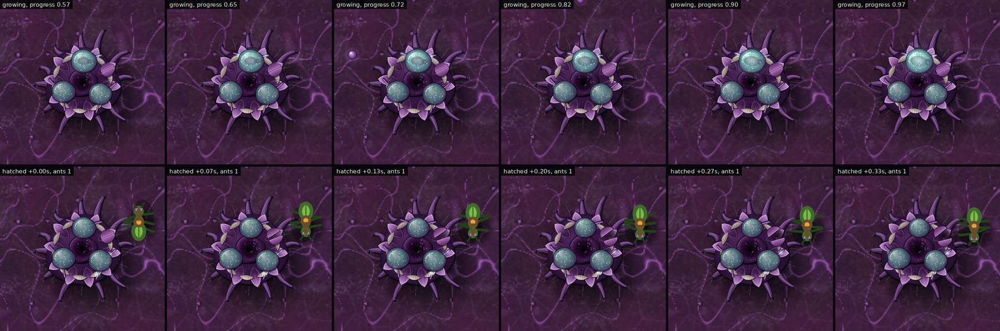

## The Bulwark gate rule (gameplay change)

The Petal Gate's description always said it was too narrow for Bulwark Ants, but v41 found the simulation let them through. v42 makes the rule real:

- Mite Ants and Thornbacks pass both gates, as before. The Bulwark passes the Maw Gate only.
- While one of our large ants (the Bulwark has `large:true`) moves, plans a route, is pushed by the crowd or is placed by a hatching, our Petal Gates count as solid for it. So collision, routes, getting unstuck, the hatching tile and crowd pushing all keep it out. Nothing squeezes, clips or teleports through.
- In Siege the Bulwark follows its own route field, built the same way and not saved.
- The Petal Gate stays shut for a Bulwark standing at it.
- A Bulwark that cannot reach its goal walks to the nearest point it can reach and waits there, re-planning every few seconds, so it moves on as soon as a way opens (for example, when a Maw Gate is built). It is never removed.
- A Bulwark loaded from an older save while standing inside a Petal Gate is moved to the nearest open ground by the game's existing unstick. The save format is unchanged.
- Enemies, the other ants and the HDF are unaffected.

Three Petal Gates and one Maw Gate in a sealed wall, three of each ant sent together. Red: Bulwarks, yellow: Thornbacks, blue: Mites.

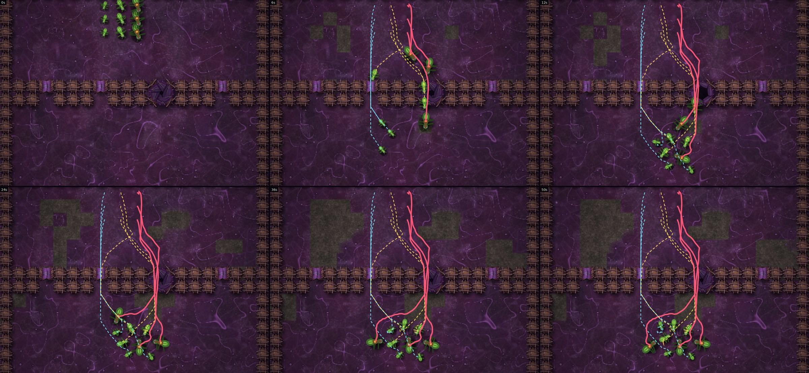

## Crowds, presets and fallback

Past 40 Spore Flaks, 60 Seed Mortars, 30 Sunlances or 16 Brood Chambers on screen, zoomed out past 0.75×, or with reduced motion, that kind is drawn without breathing, puffs, flow or stirring, but the weapons still turn to their aim and the Sunlance still lights while charging. Low quality and painted art off give the previous look, and so does a missing image (for that structure only).

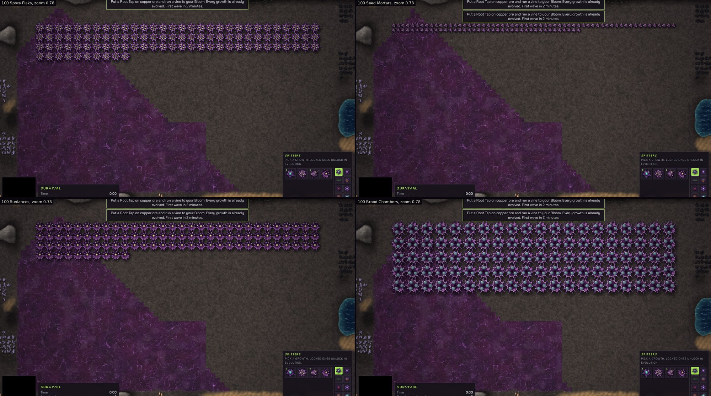
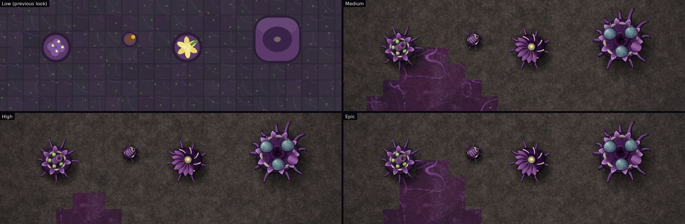
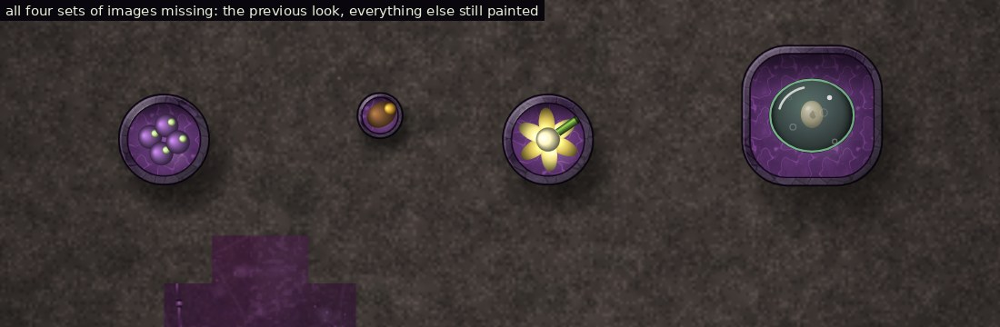

## Performance

Measured with `xperf42.js` in headless Chromium (software drawing, so a real browser with a GPU is faster), everything in view at 0.9× zoom. Each time is one `render()` plus reading one pixel back so the canvas finishes drawing inside the timed span. "Active" is the mixed set with ammunition, vigor, the Brood Chambers growing Thornbacks, flyers and ground enemies in range so everything fires and the projectiles fly, and one structure in five taking a hit each second. "Cheap" marks a kind past its on-screen limit. 100 Brood Chambers did not all fit, so that row has 99.

Medium:

| On screen | v41 median | v42 median | v41 mean | v42 mean |
| --- | --- | --- | --- | --- |
| 25 Spore Flaks | 15.3 ms | 16.1 ms | 18.2 ms | 17.3 ms |
| 50 Spore Flaks | 16.7 ms | 16.2 ms (cheap) | 17.2 ms | 17.1 ms |
| 100 Spore Flaks | 20.2 ms | 19.8 ms (cheap) | 21.6 ms | 21.4 ms |
| 25 Seed Mortars | 14.3 ms | 14.2 ms | 14.8 ms | 14.6 ms |
| 50 Seed Mortars | 14.1 ms | 15.1 ms | 14.8 ms | 15.8 ms |
| 100 Seed Mortars | 15.6 ms | 16.7 ms (cheap) | 16.5 ms | 16.7 ms |
| 25 Sunlances | 16.3 ms | 18.0 ms | 17.8 ms | 19.0 ms |
| 50 Sunlances | 17.8 ms | 16.6 ms (cheap) | 18.2 ms | 17.3 ms |
| 100 Sunlances | 23.0 ms | 20.5 ms (cheap) | 25.1 ms | 21.8 ms |
| 25 Brood Chambers | 18.8 ms | 17.8 ms (cheap) | 20.1 ms | 18.9 ms |
| 50 Brood Chambers | 24.2 ms | 21.7 ms (cheap) | 26.3 ms | 23.9 ms |
| 99 Brood Chambers | 43.0 ms | 32.0 ms (cheap) | 39.4 ms | 34.2 ms |
| 25 mixed | 16.5 ms | 16.0 ms | 18.8 ms | 17.2 ms |
| 50 mixed | 18.8 ms | 25.2 ms | 19.2 ms | 24.7 ms |
| 100 mixed | 25.1 ms | 25.5 ms | 28.2 ms | 27.1 ms |
| 25 active | 17.4 ms | 17.9 ms | 19.1 ms | 18.3 ms |
| 50 active | 21.0 ms | 22.3 ms | 21.9 ms | 24.1 ms |
| 100 active | 27.8 ms | 29.7 ms | 29.8 ms | 31.9 ms |

Most rows are within the run-to-run noise of 1 to 3 ms (the 50 mixed row repeated at 20.6 ms against 20.4 ms). The Brood Chamber and Sunlance are cheaper than the previous procedural look in crowds (100 Brood Chambers 43.0 against 32.0 ms, 100 Sunlances 23.0 against 20.5 ms). The active set is 0.5 to 2 ms slower, from the painted projectiles, beams and bursts.

On Epic (25 and 100 of each): within 2 ms either way for single kinds, the Sunlance 4 ms faster at 100, the active set within 1 ms, and 100 mixed about 4 ms slower (25.1 against 29.3 ms, repeated at 25.4 against 29.4 ms). That last one is the one measurable cost; it is still well inside a frame at 30 frames a second in software drawing.

## Tests

| Check | Result |
| --- | --- |
| `xtest42.js` part 1: the Bulwark gate rule (17 checks: Mite and Thornback through a Petal Gate; a Bulwark boxed in behind one never enters or crosses, is not removed, waits without endless attempts and goes through once a Maw Gate replaces it; the gate stays shut for it; it uses a Maw Gate six tiles along or an open gap; a mixed group; an old save with a Bulwark inside a Petal Gate; saving and loading on the way; enemies still kept out; Siege; the colony scenario) | 17 of 17 |
| `xtest42.js` part 2: the four painted structures against the game's own shots, beams, charge, production and hatchings (idle, firing, no ammunition, no vigor, change of order, exit side, hits, mends, construction, neighbours, zoom, art off and on, Low to Epic, crowds of 25 and 100, saves, HDF, missing PNG) | 32 of 32 |
| `xtest42.js` part 3: combat and production identical to v41 (shots, enemy health and positions, kills, stores, ants hatched, ammunition, for each structure), the Mortar's reach, the Flak never hitting ground targets, Sunlance charging scaling with vigor, one ant per batch, no page errors | 11 of 11 (Sunlance: 11 beams in 20 s with full vigor, 2 with little) |
| `ident42.js`: a walled colony with all four through a wave of flyers and ground enemies, the Brood Chamber hatching Thornbacks, drawn every other step | byte-identical saves on Medium and Epic: v41 against v42, v42 art off against on, v41 art off against v42 art on (102 health drops and 24 repairs in each) |
| `ident42.js` with `BULWARK=1` (the Brood Chamber hatches Bulwarks too) | v42 art off against on identical; v41 against v42 differ, as expected from the gate rule |
| Windows app (`elcheck42.js`, Electron) | all four load from the app's own files (state `ready`, as do the other painted growths), no errors. One of four launches failed to open its window while other tests were running; the other three passed |
| Full regression suite (`tests/README.md`) | see below |

**Regression suite.** Every suite ran once on the final build (35 runs):

- **Passed:** lcquick, lcskir, lcstory, lcheld, lcsave, lctest, lcart, lcbloom, lcweb, lchd, qtest, otest, vtest, ncheck, nstory, gpuapp, mtest, oldsave, btest, dtest (with and without WebGL), wbtest without WebGL, ident37, xtest37 (40 of 40), ident38, xtest38 (38 of 38), ident40, xtest40 (42 of 42), ident42 and xtest42. Some logs count a "fail" word, but each is a PASS line about the missing-image fallback ("state":"failed") or the file-not-found message that fallback test expects, as in the v41 logs.
- **Different by design (the Bulwark gate rule):** `xtest41.js` check "Petal Gate 4" (a Bulwark walks through a Petal Gate) now fails, 40 of 41. `ident41.js` compares v40 with this build in a colony where Bulwarks walk through Petal Gates, so those saves now differ; art off against on still matches. The same test with its Bulwarks swapped for Thornbacks gives byte-identical saves between v40 and v42.
- **Known failure from before v42, not new:** `wbtest` with WebGL 2, check 11 "30% coverage performance": the first frame after switching on WebGL took 277 ms against its limit (v41's run: 232 ms). It is headless software-WebGL timing and does not involve these structures.
- **Intermittent before v42:** `lcspit` crashed in its own setup (the same error as in the v40 run) and passed when run again. In `lcart` one of four Seed Pods could not be placed on the random Survival map in one configuration; the test does not fail on it, and two reruns placed all four.

## Save compatibility

No fields were added. Visual memory (flinch, fire pulse, gathering, sac state, exit direction) lives in a `WeakMap` keyed by the block and is never saved. The Bulwark's Siege route field is rebuilt, not saved. `xtest42.js` checks that the saved fields of the four are exactly v41's, that a v41 save loads, and that a v41 save with a Bulwark inside a Petal Gate loads and is unstuck.

## Files

- `index.html`: the game. New: the Bulwark rule (`NARROW`, `FLOWL`, `large` on the Bulwark), `FLAK_LAYERS`, `MORT_LAYERS`, `SUN_LAYERS`, `BROOD_LAYERS`, the `scatter`, `hail`, `lancer` and `factory` entries in `ART.plant`, `drawFlak`, `drawMortar`, `drawSun`, `drawLanceBeam`, `drawBrood`, `orgUnder`, `drawSporeShot`, `drawSeedShell`, `xClassify`, `drawXBoom`; crowd limits for the four.
- `art/plant/spore-flak/`, `art/plant/seed-mortar/`, `art/plant/sunlance/`, `art/plant/brood-chamber/`.
- `art/source/paint_weapons.js`: the painter that makes them.
- `art/ART-GUIDE.md`: new section *Painted weapons and Brood Chamber (v42)*.
- `tests/xtest42.js`, `tests/ident42.js`, `tests/xperf42.js`, `tests/xshots42.js`, `tests/xanim42.js`, and their rows in `tests/README.md`.
- `docs/v42-weapons-brood-art.md` (this report), `docs/screenshots/v42/`, the lines for the four, the Petal Gate and the Bulwark in `docs/Last-Colony-Game-Guide.txt`, `.gitignore` (`/shots42/`).

## Known limitations

- The Brood Chamber's opening follows `exitTile`, which the game works out when it hatches; the drawing re-reads it twice a second, so if a wall is built beside it the opening can take up to half a second to turn.
- A Bulwark with no way to its goal waits at the nearest reachable point rather than finding a new task.
- HDF turrets and factories keep their colony look; only the hive's are painted.
- The rendering times are from headless Chromium with software drawing.

## Follow-up: root colour

The roots under every painted growth (19 layers, the Bloom's included) are now a turquoise with a slight purple lean, near the Bloom's centre, made with `art/source/recolor_roots.py` (see *Root colour* in the art guide). Only the colour changed.

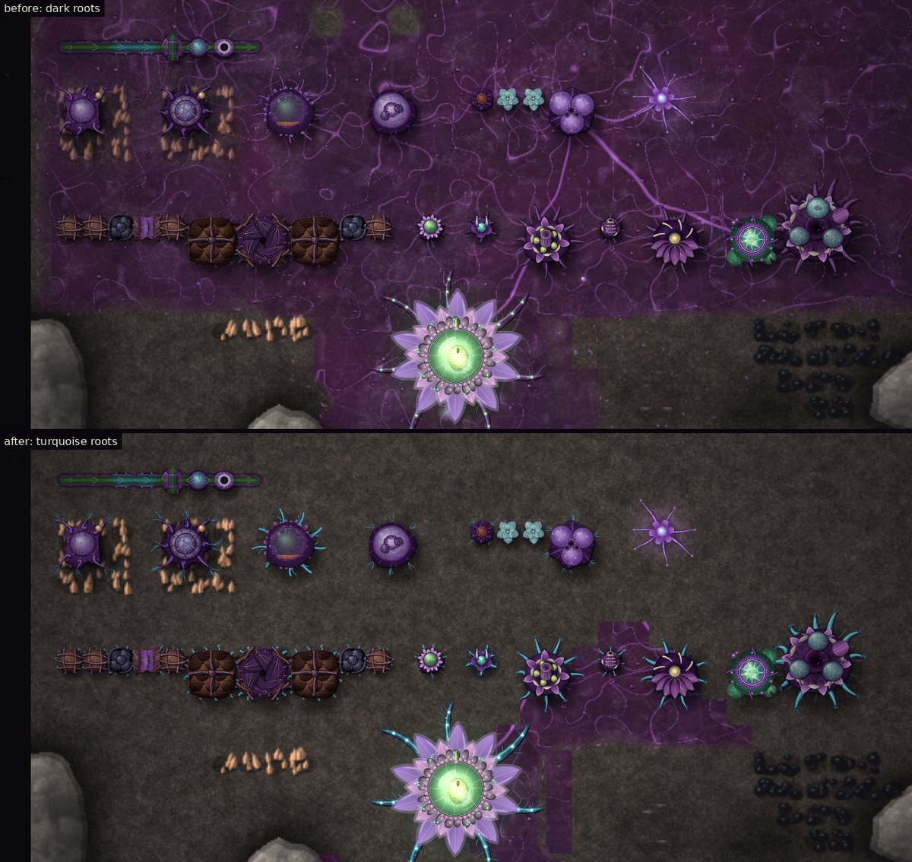
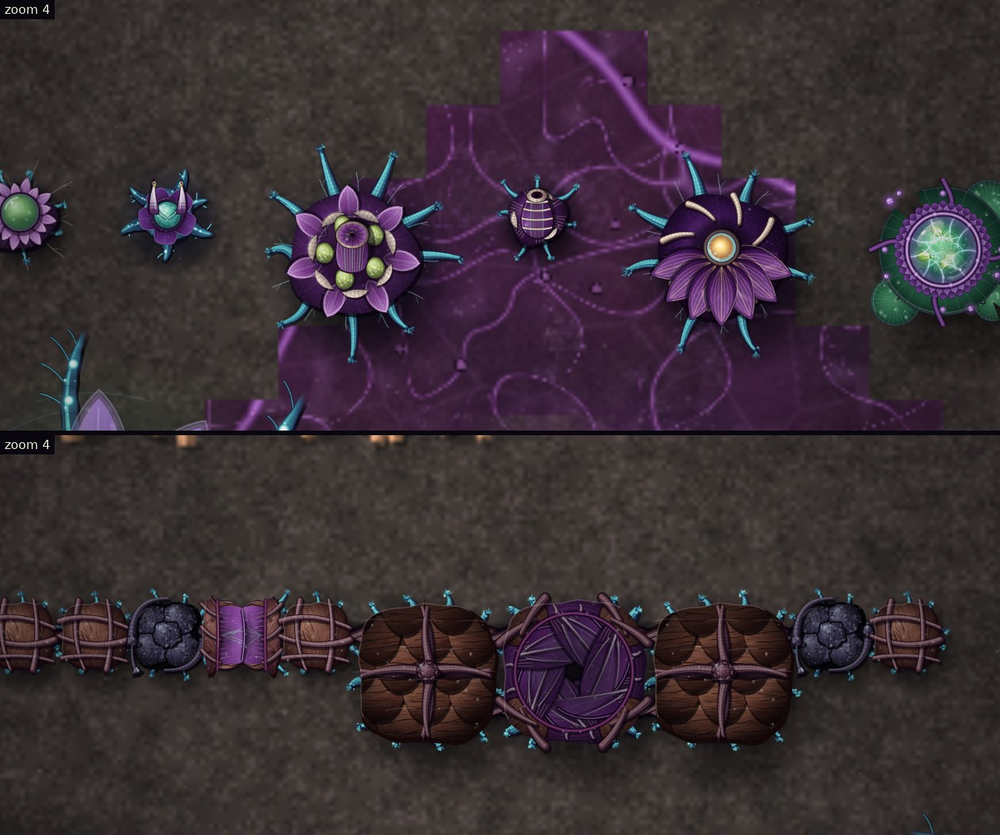
