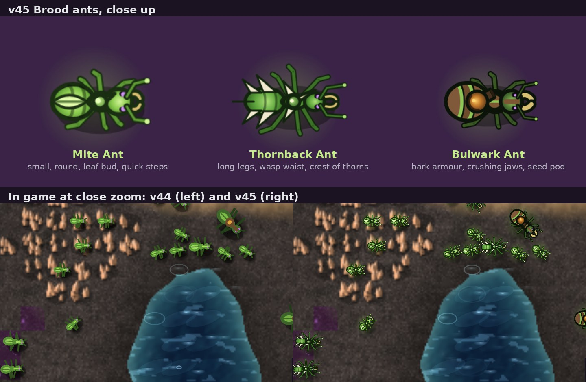

# v45: the ants redrawn

v45 is a visual overhaul of the three Brood ants: the Mite Ant, the Thornback Ant and the Bulwark Ant. It changes no stats, logic or saves, and it doesn't touch the HDF units. The change is in the one game file (`index.html`).

## What was there

All three ants were drawn every frame by one function (`drawTank`), from the same few shapes:
- three ellipses for the body;
- a leaf on the back;
- six straight legs that wobbled on a timer, whether or not the ant was moving;
- a triangle or barrel for the gland.

The Mite and the Thornback were the same drawing at two sizes. When an ant died it vanished into the generic explosion.

## What changed

### Shape language (the roles read without colour)

| Ant | Silhouette | Back | Gland |
|---|---|---|---|
| Mite Ant (basic) | The smallest. A round gaster, a big head and short legs | A pale leaf bud along the spine | A small green sap bulb with a short spout |
| Thornback Ant (quick warrior) | Longer and leaner: long legs, a narrow waist and a long thin head with long jaws | A crest of pale thorns raked back along the body, plus a tail thorn | A long pale thorn spine |
| Bulwark Ant (heavy) | Broad and heavy: a wide gaster and thorax and short, thick legs | Overlapping bark armour plates with mossy edges, plus a bark shield on the thorax and a ridge on the head | A bark-husked seed pod with a glowing amber core and a stubby mouth |

Every ant now has:
- **Body:** a head, thorax, waist node and gaster, each shaded from a lighter spine to a darker edge, with segment bands.
- **Legs:** six jointed legs. The front pair angles forward and the hind pair back, so the outline points the way the ant faces.
- **Head:** curved amber mandibles, elbowed antennae with pale tips, and compound eyes with the hive's violet glint.
- **Readability:** a dark outline and a soft hive-green halo, so ants stand out on dark ground, purple Rootweb and sand alike.

The Mite and Thornback are drawn 14% and 6% larger than their hit circles, so they read at normal zoom. Hit areas are unchanged.

### Motion

- **Walk:** an 8-step tripod gait, with front and hind legs on one side moving together with the middle leg on the other. Feet lift and swing. The cycle advances with the distance the ant actually covers, so its feet don't slide, and it stops when the ant stops. Each kind has its own stride: the Mite skitters, the Thornback lopes and the Bulwark plods with a heavier body bob.
- **Turning:** the body eases round to a new heading and leans slightly into the turn, instead of snapping. The gland still turns separately towards its target.
- **Idle:** the gaster breathes, the antennae feel the air and the mandibles work, all slowly and out of step between ants, so a waiting swarm doesn't pulse in unison.
- **Attack:** the gland kicks back and the body jolts a little when it fires, with a flash at the gland's mouth. The thorn, seed or sap that comes out is the game's own projectile, unchanged.
- **Hit:** the whole ant flashes white, following its outline rather than a box.
- **Death:** the ant flashes white, curls its legs in, rolls, sinks and fades over 1.6 s, while a spray of sap (amber from a Bulwark) scatters. The game's own explosion and scorch mark are unchanged.

## How it stays cheap

- **Pre-drawn frames:** each kind is drawn once, when first needed, into 13 frames (8 walk, 4 idle, 1 death) plus a gland sprite, at 6 times screen size so it stays crisp at full zoom on high-DPI screens. After that, an ant costs one drawImage for its body and one for its gland, plus one more while flashing.
- **No game state:** walk phase, eased facing and movement are kept in a `WeakMap` keyed by the ant. Deaths go in a render-only list capped at 120. No field is added to an ant and nothing new is saved.
- **No randomness:** each ant's look comes from its id. The game's random sequence is never touched, so drawing cannot change what happens.

## Tests

- **New:** `tests/xtest45.js` has 11 checks, all passing in headless Chromium.
  - v44 and v45 give byte-identical saves with the new ants drawn throughout. That held in three 95-second fights: Survival with seeds 7 and 11 and Base Siege with seed 3, drawn every 1, 3 and 5 steps, with 14, 1 and 14 ant deaths. It also held with the screen never drawn.
  - No fields are added to ants.
  - The three kinds' silhouettes overlap by 59 to 74% at the same size.
  - The frames are cached and differ from step to step.
  - The walk cycle moves exactly with distance, and turning eases.
  - Hit flash, firing, nest previews and deaths draw with no errors.
  - With 200 ants on screen, a median frame took 29.9 ms in v45 against 29.1 ms in v44, and the slowest tenth of frames 38.3 ms against 40.2 ms. Drawing just the 200 ants took 10.9 ms against 19.3 ms. These are headless software-rendering figures from the final build, measured during the full regression, so the whole-frame numbers are within noise; the ant drawing itself is clearly cheaper. The numbers are in `tests/perf45.json`.
  - A side note: drawing the screen or not already changed the game in v43 and v44, because the camera position affects play. That is not new: v45 matches v44 both when drawn and when never drawn.
- **Windows app:** `tests/elcheck45.js` ran in the packaged app (Electron 33.2.1). 18 ants fought for 40 s with 300 frames drawn, then 3 died on screen, with no page errors.
- **Regression:** all 41 suites ran on the v45 build, and every one gives the same result as v44, check for check. That includes xtest43 (71 checks) and xtest44 (36 checks). The v44 to v45 save-identity run (`ident42.js` with `OLD=lc2_v44_index.html`, normal and Bulwark) says "ALL PASS: identical saves". `wbtest` with WebGL off failed its Rootweb repaint timing once while the Windows app check ran on the same machine, and passed 17 of 17 run on its own. The probe scripts that print figures rather than pass or fail (`lcart`, `lcspit`, `lcheld` and the rest) ran with no errors; their figures vary from run to run because they use unseeded maps.
