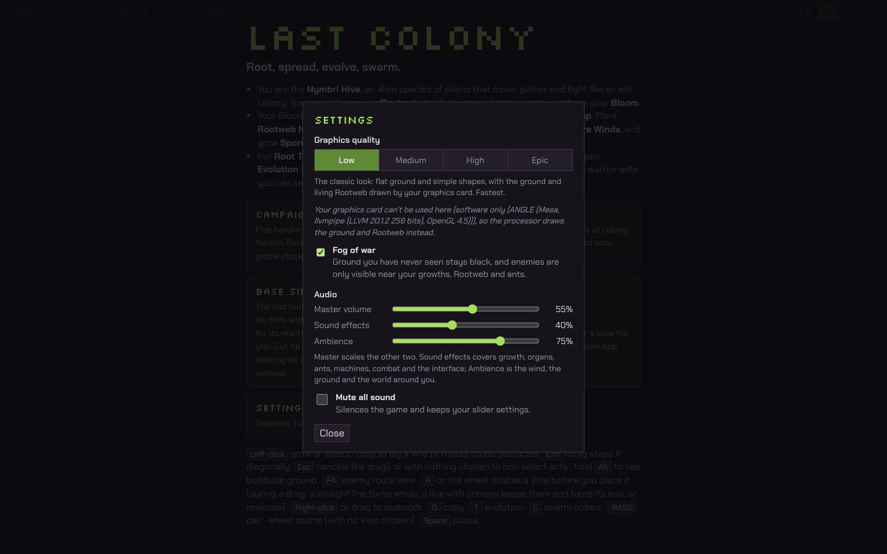
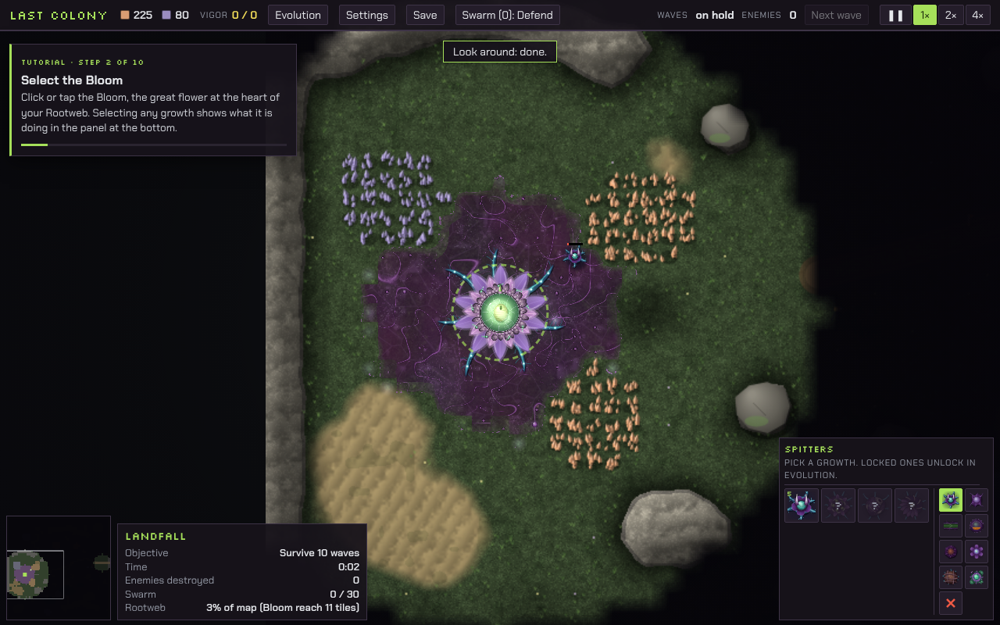
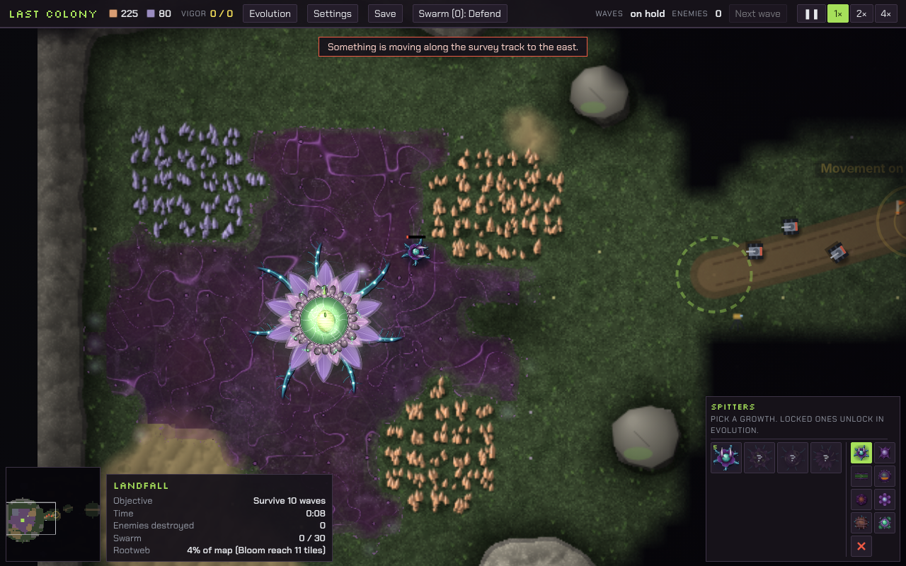
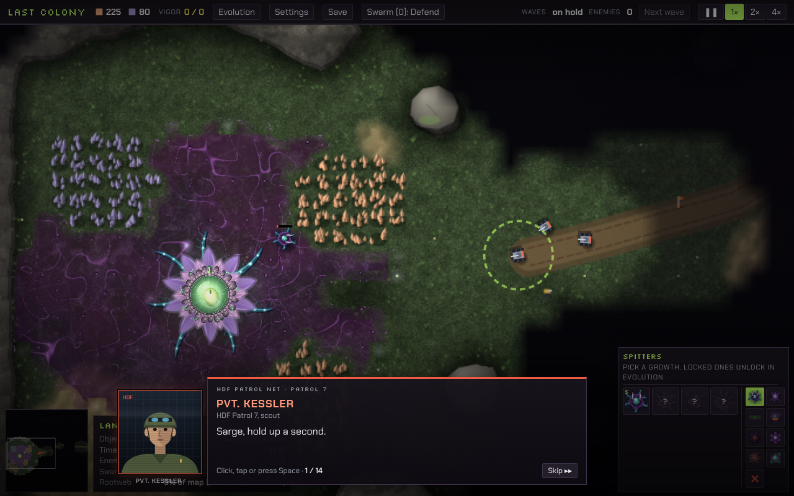

# v46: sound, ambience and the event camera

Before v46 the game was silent. v46 adds a complete sound system, ambience for every sector, an Audio section in Settings, a camera that pans to important story moments, and a faster first contact in Mission 1. It changes no stats, balance, logic or saves: with the same seed, v45 and v46 give byte-identical saves with sound playing.

The changes are in the game file (`index.html`) and the new `audio/` folder.

## The sounds

There are 145 sounds from 74 recipes. All are original and generated by the scripts in `audio/source/`, so no samples or licences are involved (see `audio/README.md`). They are mono MP3s, about 3 MB in all, packed into one script, `audio/sounds.js`, that loads after the first click or key press. Packing them in a script lets the Windows app, which opens the game from disk, load them with no network.

The hive sounds wet, fibrous and alive. The HDF sounds like metal, motors and guns. Nothing is a beep.

| Group | What you hear, and when |
| --- | --- |
| Growth and building | The Rootweb creaks quietly underground as it spreads. Vines are laid with a fibrous slap, and grow with a creak. Organs are planted with a wet squelch, and finish growing with a soft swell. A refused placement gives a dull thud, and turning a vine gives a soft click. Damaged growths tear, destroyed growths burst, and healing gives a soft rising wash. |
| Sap Burner | A soft combustion roar loops only while it has fuel burning, with a whumph each time it takes coal in. It fades out when the fuel runs out. |
| Sunleaf | A warm hum and slow pulses, only while it is making vigor. |
| Spore Bellows | Breathing in time with its drawing, and a puff on each exhale, only while it works. |
| Other organs | Root Taps draw with a sucking pull as they deliver ore. Resin Glands and Chitin Vats churn as they process. Brood Chambers hatch with a wet split. Bark Gates creak open and shut. |
| Hive weapons | Thorn Spitters spit, the flak organ coughs, the mortar launches and its seed bursts, and the Sunlance hisses. |
| Ants | One shared scuttle bed that grows with the number of ants moving, so a swarm is never a hundred sounds. Each kind has its own shot: the Mite's sap flick, the Thornback's thorn crack and the Bulwark's heavy seed thump. Hits and deaths are wet. |
| HDF vehicles | Each kind has its own engine, built from firing pulses, exhaust and track or rotor noise: the Scout Tank, Flame Tank and Siege Tank, the Rammer Drone's whine, the Interceptor's jet and the Bomber's drone. Guns, cannon, flamers and zaps, shells landing, metal hits and explosions are all metal and fire. |
| Interface | Soft select, tool, cancel, open and close clicks, an alert, a success chime, and a radio crackle or a hive murmur when a story line appears. |

### How a sound is chosen and placed

- **Real events only.** Each sound is triggered by the game code where the thing actually happens: the fire call, the hit, the growth finishing, the coal going in. Organ loops read the organ's real state, and stop when it stops.
- **Position.** Sounds play at full level inside the view and fall off with distance outside it. Off-screen sounds are also muffled and panned left or right by where they are. Zooming out lowers them a little.
- **Limits.** At most 24 voices play at once. Each sound has its own volume, priority, cooldown and limit on copies. A sound of higher priority (an explosion, a growth destroyed) takes the place of a lower one (a creak). At most 4 vehicle engines play, those nearest the view, fading in and out.
- **Clean up.** An engine stops as soon as its vehicle dies. Organ loops stop when the organ is destroyed or idle. Everything stops on game over, a new game, a load or leaving a sector. The sound engine pauses when the window is hidden.
- **No effect on the game.** The sound code has its own random sequence and never touches the game's, so it cannot change what happens.

## Ambience

Each sector has a 24-second wind bed of its own: meadow, ash, mountain pass, frost and the colony valley. Under it sit a low ground rumble and, on soft ground, the small lives in the soil. Each loop plays as two offset, panned copies, so it sounds wide and doesn't repeat audibly. Distant one-shots come every 9 to 27 seconds, fitting the sector: far rumbles, groans, gusts, cracking ice and far-off machinery.

The ambience follows what is going on:
- **Quiet:** wind, soil and ground.
- **Expanding colony:** the hive's own low hum rises with the Rootweb, the number of growths and how fast they are growing.
- **Humans approaching:** a distant mechanical rumble rises as HDF ground machines come within range but are still off screen, and clears into their own engines as they arrive.
- **Combat:** a tense layer rises with the fighting. It eases back over about 20 seconds once the fighting stops, never in a jump.
- **Story lines** duck the effects to 50% and the ambience to 70% while they are on screen, so dialogue is never drowned out.

All changes ease smoothly. There is no music.

## Audio settings

Settings now has an Audio section with Master volume, Sound effects and Ambience sliders, from 0 to 100%, each showing its percentage, and a Mute switch.
- Master multiplies the other two in the mixer. For example, Master 50%, Sound effects 80% and Ambience 60% plays effects at 40% and ambience at 30%. Setting Master back to 100% leaves the other two where they were.
- Changes apply at once and are saved in the browser's (or the app's) local storage. 0%, or Mute, is exact silence.
- The defaults are Master 80%, Sound effects 80% and Ambience 60%.

## The event camera

Important story moments pan the camera smoothly to what is happening and hold it there. Arrow keys, dragging, the wheel, H and the minimap wait until the moment ends, though you can still turn a vine. A moving subject is kept in frame. When the moment ends, the camera pans back to exactly where you had it, at your zoom, and the controls work again at once. Touching them during the pan home stops it where it is.

The camera moves only for the story beats that already moved it (the ones that point at a place) and for Mission 1's first contact. Ordinary play is never interrupted. A save made during a moment stores your own camera, and loading it resumes the moment. A restart or a new game drops any moment. A second moment during the first still returns to the view from before the first. A subject that is destroyed leaves the camera where it was. The camera always stays inside the map.

## Mission 1: first contact

In v45 the patrol of three Scout Tanks appeared far down the survey track and took about 35 seconds of game time to reach the hive, with nothing to watch in between.

In v46 the same three Scout Tanks start just outside the area the camera frames for the scene, on the same road, so they drive in naturally. If that start point is inside your own view when the scene begins, they wait further back out of sight and set off once the camera has moved away, so nothing ever appears or vanishes on screen. On the way out they drive back the way they came and are removed only when out of view.

The sequence:
1. You hear their engines first, off screen, with the distant rumble rising (0.4 s in the test).
2. The camera pans to the meeting place.
3. The tanks drive into the shot at about 4.5 s.
4. The tanks reach the turret at about 8.5 s, against 34.8 s before.
5. The dialogue, the event order (patrol, command, general, after) and the objectives are unchanged.
6. After the patrol leaves, the engines and rumble die away and the camera returns to your view.

| Your view when the event starts | The patrol drives into the shot | The meeting |
|---|---|---|
|  |  |  |

## Tests

- **New: `tests/xtest46.js`** has 35 checks, all passing in headless Chromium (output in `tests/xtest46.log`). It also passed inside the full regression run, apart from the earlier form of the cost check, described under Cost.
  - **Settings.** The three sliders set their own gains and show their percentages. Master 50% with 80% and 60% gives 40% and 30% in the mixer itself. Master back at 100% leaves the other two untouched. The settings come back in a new session.
  - **Silence.** Mute, or both sliders at 0%, gives an output where every sample is 0 during a fight. Effects at 0% plays no effect voice, engine or organ loop while the ambience goes on. Ambience at 0% stops every ambience loop.
  - **Real actions only.** An idle Sap Burner and a Thorn Spitter with no target are silent. Coal starts the burner's whumph and loop, and running out fades it. With no enemies, no combat sound plays. A spitter firing at a vehicle spits and its thorns clank on the hull.
  - **Crowds.** With 100 ants fighting, at most 24 voices played at once (20 at most were measured), at most 3 copies of any sound, 4 engines and one shared scuttle bed.
  - **Clean up.** Destroyed vehicles' engines stopped within 89 ms. Dead ants left no scuttle. A burning Sap Burner that is destroyed falls silent. Game over leaves nothing running.
  - **Ambience.** The rumble rises for approaching machines, a fight raises the combat layer, both ease back afterwards, and no step between checks a tenth of a second apart exceeds 0.06 in gain.
  - **Cost.** In a 200-ant fight on one page, with sound switched on and off in turns, the median frame was 16.7 ms with sound. The game thread's own sound work was measured directly around every sound call and update: 0.11 ms per game step, and 0.06 ms for each 10-per-second sound update. That is about 0.4% of the game thread at 30 steps a second. A play itself costs about 37 µs, and a request turned away by a cooldown or cap about 0.3 µs. 12,400 sounds were requested and at most 24 played at once.
    - Whole-step times with sound on and off (1.25 ms against 1.11 ms in the final run, 1.14 against 1.09 in an earlier one) are reported but not judged. The browser mixes audio on its own thread, which competes for the processor on the busy 4-core test machine, so that comparison is noisy.
    - The numbers are in `tests/perf46.json`.
  - **Identity.** v45 and v46 give byte-identical saves with sound playing: Survival seed 7 and Base Siege seed 3 drawn every 3 and 5 steps with 13 and 14 ant deaths, and Survival seed 11 never drawn.
  - **Campaign.** These are the Mission 1 figures above, checked against v45. The same three Scout Tanks start on open ground inside the map, none in the player's view. They are heard before they are seen. The camera holds against keys and the wheel. The story order is unchanged. The camera ends exactly where the player had it, and the controls move it at once. Nothing vanishes on screen.
  - **Saves and restarts.** A save during the scene keeps the player's camera, and loading it re-frames the scene. Restarting mid-scene unlocks the camera. Two overlapping moments return to the first view. Mission 2's depot line pans, holds and returns.
  - There were no page errors.
- **Windows app: `tests/elcheck46.js`** ran in the packaged app (Electron 33.2.1, opened from `file://` with no server):
  - all 145 sounds decoded after a click;
  - a fight was audible through the mixer;
  - the master gain followed the slider, and Mute gave exact silence;
  - the settings (55%, 40%, 75%) were still there when the app was opened again;
  - there were no page errors.
- **Regression:** all 40 earlier suites ran on the v46 build. Every one gives the same result as v45, check for check, except where noted below. The summary is in `tests/reg46-summary.txt`.
  - **Identical saves.** The v45 to v46 save-identity run (`ident42.js` with `OLD=lc2_v45_index.html`, normal and Bulwark) says "ALL PASS: identical saves", and so does the v44 to v46 run.
  - **Updated, intentionally.** `tests/mtest.js` checked where the camera was 0.15 to 0.2 s after a mission's ending began. The camera now pans there smoothly instead of jumping, so the check now waits up to 4 s for it to arrive. All 18 mission checks pass. `lcstory` (a probe) shows the shorter Mission 1 walk: 3 samples on the way in instead of 11, with the same states, ceasefire, dialogue order and no errors.
  - **Known flaky.** `lcspit` stopped once on a spitter missing from its random scene. It does the same on v45: 2 of 4 runs on v45 stopped the same way, and on v46 it passed on its second rerun.
  - **Unchanged results.** The rest match v45 exactly, including the checks that already failed there (old-version comparisons and software-GPU performance thresholds). `wbtest` with WebGL 2 passed 16 of 17, one more than v45.

## Listening

The sounds were designed and balanced by measurement: spectrograms, loudness and peak levels, and recordings of the game's real mixer output. They have not been judged by ear yet, so please listen. The recordings are in `docs/audio/v46/`:

| File | What it is | Loudness |
| --- | --- | --- |
| `battle.mp3` | 30 s of a Survival fight: spitters, flak, a mortar and 15 ants against Scout, Flame and Siege Tanks, Rammer Drones, Interceptors and Bombers | -17.3 LUFS, peak -0.9 dBFS |
| `colony.mp3` | 30 s of a quiet colony: a Sap Burner fed with coal, Sunleaves, a Spore Bellows, a Root Tap and a Healing Pod, with ants walking | -21.0 LUFS |
| `mission1.mp3` | 30 s of Mission 1's first contact, from the engines in the distance to the dialogue | -24.0 LUFS |
| `sampler.mp3` | every one of the 145 sounds in turn (5:44); `sampler.txt` lists where each one starts | |

Any sound can be made louder, quieter or different by changing its line in the mixer table (`SFX` in `index.html`) or its recipe in `audio/source/sounds.js`.
